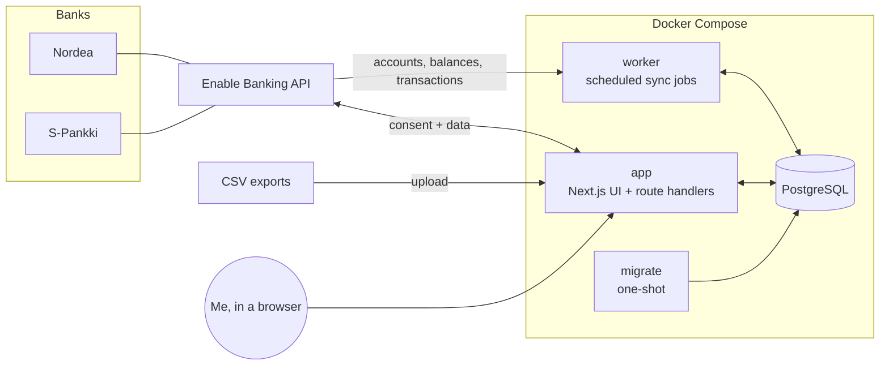
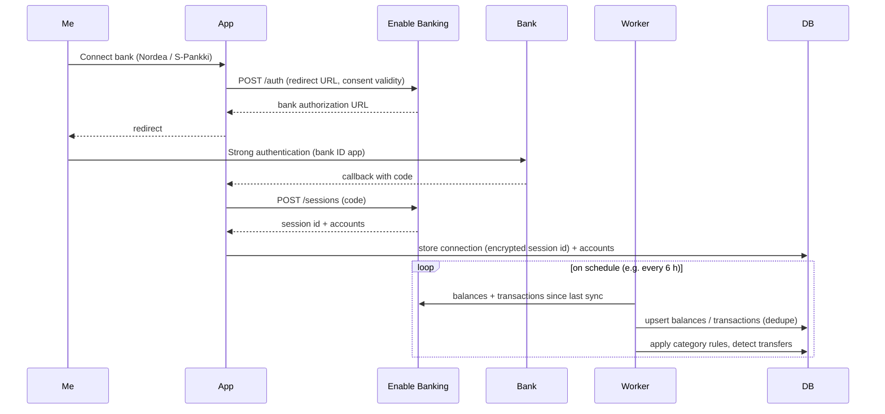

# Architecture

## Overview



| Service   | Role                                                                                                          |
| --------- | ------------------------------------------------------------------------------------------------------------- |
| `db`      | PostgreSQL 18. Data lives in the `pgdata` volume. The port is bound to `127.0.0.1` only.                      |
| `migrate` | Applies Drizzle migrations, then exits. `app` and `worker` start only after it succeeds.                      |
| `app`     | Next.js server: dashboard UI, the bank-connection flow (OAuth-style redirect), CSV upload, "sync now".        |
| `worker`  | Long-running Node process. It runs scheduled jobs with node-cron: bank sync, later price updates and backups. |

The app and the worker share the same code in `src/server`. The worker is not a separate codebase.

## Directory layout

```
src/
  app/                 Next.js App Router: pages, layouts, route handlers (UI + HTTP)
    (app)/             Route group: every page inside the app shell (layout.tsx renders
                       AppShell); Dashboard, transactions/, reports/, connections/, settings/
    login/             Login page (outside the shell, public)
    api/health/        Health check (DB connectivity, public)
  proxy.ts             Optimistic auth check: no session → /login (401 under /api)
  components/          React components (app only, never imported by src/server)
    app-shell/         Header, sidebar navigation, mobile menu (sheet)
    ui/                shadcn/ui primitives (generated by the shadcn CLI, Radix based)
    empty-state.tsx    Placeholder for pages without data yet
  lib/                 App helpers: cn() (utils.ts), the navigation items
    auth/              Server-only (next/headers): session data access layer
                       (session.ts: verifySession()), login/logout Server Actions;
                       routes.ts: public paths and the proxy's accessDecision()
  server/              Server-side domain code, shared by app and worker
    env.ts             Typed, validated environment variables (zod; getAuthEnv() for
                       the login secrets, which only the app needs)
    auth/              Password hashing (argon2id), session sealing and re-issue
                       (iron-session), login check with backoff, `pnpm auth:hash` CLI
    db/
      client.ts        Drizzle client (postgres.js pool), lazily created
      schema/          Table definitions, one file per domain area (banking, categories,
                       transactions, sync; shared column builders in columns.ts)
      migrations.ts    applyMigrations(): shared by migrate.ts and the L2 tests
      migrate.ts       Migration runner (used by the `migrate` service and pnpm db:migrate)
    dedupe-hash.ts     Fallback identity of a transaction (normalised date, amount, text)
    providers/         FinancialProvider interface + implementations     (FIN-005)
      enable-banking/  Enable Banking client and provider                (FIN-006)
      csv/             CSV import provider                               (FIN-012)
    sync/              Sync orchestration: accounts, balances, txns      (FIN-008/009)
    categorization/    Rule engine, transfer detection                   (FIN-014)
    queries/           Read models for the dashboard                     (FIN-016+)
  worker/
    index.ts           Worker entrypoint: registers jobs, graceful shutdown
    jobs.ts            Job registry (name, cron schedule, run function)
tests/
  unit/                Vitest unit project (L1)
  integration/         Vitest + Testcontainers Postgres 18 (L2); helpers/postgres.ts
  e2e/                 Playwright against the built app (L3); support/server.ts is the
                       webServer (Testcontainers Postgres + build + standalone server);
                       the run fails if the app server logs an error line
                       (support/server-errors.ts), even when every test passed
  fixtures/            Synthetic or anonymised fixtures only, never real data
drizzle/               Generated SQL migrations (committed)
secrets/               Private keys (gitignored), mounted into containers
.claude/               Claude Code permissions and the harness plugin pin (hooks, skills and the
                       evaluator come from the shared harness; project rules in harness.config.json)
docs/                  Plan, architecture, tech stack, tickets, decisions, harness docs
```

Folders marked with a ticket number don't exist yet. They are created by that ticket.

## Data flow: bank sync



## Data model

The core tables (F-002, `src/server/db/schema/`, first migration `drizzle/0000_init.sql`). Amounts are stored as **integer minor units** (cents, `bigint`, read as a JS `number`) together with an ISO-4217 `char(3)` currency code. Floats are never used for money. Every id is a `uuid`; every point in time is `timestamptz`; calendar days (`booking_date`, `value_date`, snapshot `date`) are `date`. Every table has `created_at` / `updated_at`.

| Table               | Purpose                                   | Key columns                                                                                                                                                                                                        |
| ------------------- | ----------------------------------------- | ------------------------------------------------------------------------------------------------------------------------------------------------------------------------------------------------------------------ |
| `institutions`      | Banks, brokers, exchanges                 | `id`, `name`, `country`, `provider` (`enable_banking`, `csv`, …), `provider_ref`                                                                                                                                   |
| `connections`       | One authorized link to an institution     | `id`, `institution_id`, `provider`, `session_ref` (encrypted), `status`, `consent_expires_at`, `last_synced_at`                                                                                                    |
| `accounts`          | Any account that holds value              | `id`, `connection_id?`, `institution_id`, `type` (`checking`, `savings`, `brokerage`, `crypto`), `name`, `iban?`, `currency`, `provider_account_ref`, `archived`                                                   |
| `balance_snapshots` | Balance history (one per account per day) | `account_id`, `date`, `amount_minor`, `currency`, `balance_type`                                                                                                                                                   |
| `transactions`      | Booked and pending transactions           | `id`, `account_id`, `provider_txn_ref?`, `dedupe_hash`, `booking_date`, `value_date`, `amount_minor`, `currency`, `counterparty`, `description`, `status`, `category_id?`, `category_source`, `transfer_group_id?` |
| `categories`        | Spending/income categories (hierarchical) | `id`, `name`, `parent_id?`, `kind` (`expense`, `income`, `transfer`), `color`                                                                                                                                      |
| `category_rules`    | Auto-categorization rules                 | `id`, `category_id`, `match_field`, `match_type`, `pattern`, `priority`                                                                                                                                            |
| `sync_runs`         | Sync log                                  | `id`, `connection_id`, `started_at`, `finished_at`, `status`, `error`, counts                                                                                                                                      |

Enums: `account_type` (`checking`, `savings`, `brokerage`, `crypto`), `connection_status` (`active`, `expired`, `revoked`, `archived`), `transaction_status` (`booked`, `pending`), `category_source` (`none`, `rule`, `manual`), `category_kind` (`expense`, `income`, `transfer`), `rule_match_field` (`counterparty`, `description`), `rule_match_type` (`contains`, `equals`, `regex`), `sync_status` (`running`, `succeeded`, `failed`). `provider` columns are open text so a new provider needs no migration; `balance_type` holds the provider's ISO 20022 code (`CLBD`, `ITAV`, …).

Idempotency constraints (syncs and imports upsert on them):

- `transactions`: unique `(account_id, provider_txn_ref)` (NULL refs never collide) and unique `(account_id, dedupe_hash)`, where `dedupe_hash` is `dedupeHash()` from `src/server/dedupe-hash.ts`: SHA-256 of the normalised booking date, amount, counterparty and description. Indexes on `(account_id, booking_date)`, `category_id` and `transfer_group_id`.
- `balance_snapshots`: unique `(account_id, date, balance_type)`.
- `categories`: unique `(parent_id, name)` with `NULLS NOT DISTINCT`, so seeded top-level names are unique too; `institutions`: unique `(provider, provider_ref)`.

Planned investment tables (FIN-019): `assets` (ticker or coin, asset class), `holdings` (account + asset + quantity), `investment_transactions` (buy, sell, dividend) and `prices` (asset, date, price). Brokerage and crypto accounts reuse `accounts`, so net worth is a single query across every account type.

## Provider abstraction

Every data source implements one interface (to be finalized in FIN-005):

```ts
interface FinancialProvider {
  id: ProviderId; // "enable_banking" | "csv" | later "kraken", "nordnet_csv", ...
  listAccounts(connection: Connection): Promise<ProviderAccount[]>;
  getBalances(
    connection: Connection,
    account: ProviderAccountRef,
  ): Promise<ProviderBalance[]>;
  getTransactions(
    connection: Connection,
    account: ProviderAccountRef,
    range: { from: Date; to?: Date },
  ): Promise<ProviderTransaction[]>;
}
```

Providers return **normalized** DTOs. Mapping from provider-specific JSON happens inside the provider, and the sync layer only ever sees normalized data. Investment providers will add an optional `getHoldings()`.

## Conventions

- **Server code boundary.** Everything under `src/server` must run in plain Node, because the worker imports it. Don't import Next-only modules there (`next/headers`, `server-only`, and so on). Next-specific data access belongs in `src/app` or in `src/server/queries` files that only the app imports.
- **Environment.** Read the environment only through `getEnv()` from `src/server/env.ts`. Add new variables to its zod schema and to `.env.example`. Variables only the web app needs (the login secrets) are in a second schema read by `getAuthEnv()`, so the worker runs without them.
- **DB access.** Use `getDb()`. It is created lazily, so `next build` works without a database.
- **UI.** Pages that belong to the app go into `src/app/(app)/` and get the shell from its layout; a page that must not show it (e.g. login) lives outside the group. Components come from shadcn/ui (`pnpm dlx shadcn@latest add <name>` writes them to `src/components/ui`); a new navigation section is one entry in `NAV_ITEMS` (`src/lib/navigation.ts`). Next 16 keeps visited pages mounted but hidden, so e2e locators that are not role based (e.g. `getByTestId`) need `.filter({ visible: true })`.
- **Cache Components** are enabled (`cacheComponents: true`). Anything reading cookies or DB data at request time must sit behind `<Suspense>` or call `connection()`. See `node_modules/next/dist/docs/` for Next 16 specifics.
- **Time zone.** Dates are stored in UTC. Calendar grouping (months, days) uses `APP_TIMEZONE` (`Europe/Helsinki`).

## Security

- Single-user login protects every page and route except `/login` and `/api/health` (FIN-004, D-007), even though the app runs locally. `AUTH_PASSWORD_HASH` holds an argon2id hash of the one password (`pnpm auth:hash`). A login sets `pf_session`: an iron-session seal (`SESSION_SECRET`) of the issue time, `httpOnly`, `sameSite=lax`, `secure` in production, valid 30 days and re-issued by the proxy once a day (not on Server Action calls, which may change the cookie themselves: logout deletes it), so it expires 30 days after the last visit. Sessions are stateless: logout deletes the cookie, rotating `SESSION_SECRET` signs out every browser. After 5 consecutive wrong passwords each attempt waits 1 s, 2 s, 4 s, … (at most 15 min) after the last failure; the counter is in memory and global, so a persistent attacker who can reach the app could keep the owner locked out (accepted: the app is bound to `127.0.0.1`; a restart clears it). `/api/health` is answered before the session check, so it works even when the login secrets are missing.
- `src/proxy.ts` only redirects optimistically. Server Components, Server Actions and Route Handlers that touch data call `verifySession()` (`src/lib/auth/session.ts`) themselves; a Server Action is a POST to its page and must never rely on the proxy matcher. `getSession()` awaits `io()` (`next/cache`) before it checks the expiry, because with Cache Components a clock read after `cookies()` still counts as prerendering in the runtime prefetch (`Date.now()` → logged `blocking-prerender-current-time` error); other request-time code that reads the clock needs the same.
- The Enable Banking private key lives in `./secrets/` (gitignored) and is mounted read-only.
- Session and consent identifiers are encrypted at rest with AES-256-GCM, using `ENCRYPTION_KEY`.
- The database and app ports are bound to `127.0.0.1`.
- The integration is read-only (account information only). The app never initiates payments.
