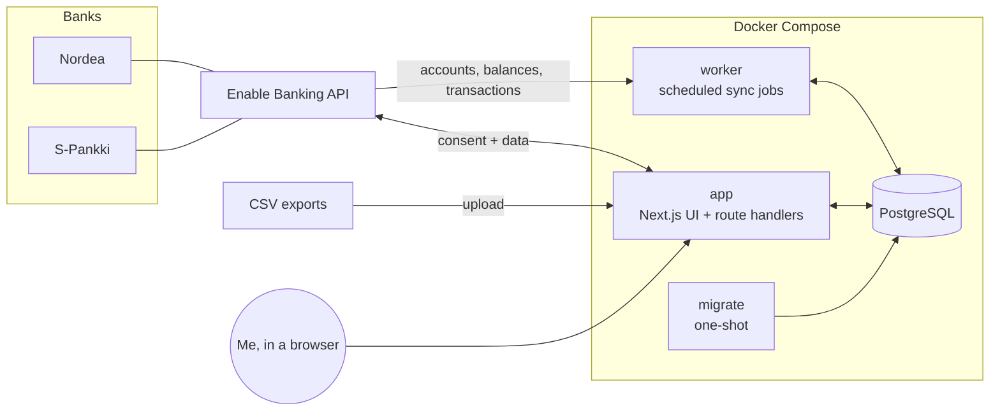
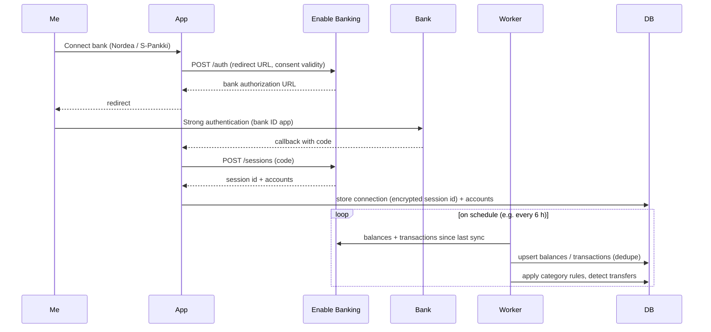

# Architecture

## Overview



| Service   | Role                                                                                                          |
| --------- | ------------------------------------------------------------------------------------------------------------- |
| `db`      | PostgreSQL 18. Data lives in the `pgdata` volume. The port is bound to `127.0.0.1` only.                      |
| `migrate` | Applies Drizzle migrations, then exits. `app` and `worker` start only after it succeeds.                      |
| `app`     | Next.js server: dashboard UI, the bank-connection flow (OAuth-style redirect), CSV upload, "sync now".        |
| `worker`  | Long-running Node process. It runs scheduled jobs with node-cron: bank sync, later price updates and backups. |

The app and the worker share the same code in `src/server`. The worker is not a separate codebase.

## Directory layout

```
src/
  app/                 Next.js App Router: pages, layouts, route handlers (UI + HTTP)
    api/health/        Health check (DB connectivity)
  server/              Server-side domain code, shared by app and worker
    env.ts             Typed, validated environment variables (zod)
    db/
      client.ts        Drizzle client (postgres.js pool), lazily created
      schema/          Table definitions, one file per domain area
      migrate.ts       Migration runner (used by the `migrate` service)
    providers/         FinancialProvider interface + implementations     (FIN-005)
      enable-banking/  Enable Banking client and provider                (FIN-006)
      csv/             CSV import provider                               (FIN-012)
    sync/              Sync orchestration: accounts, balances, txns      (FIN-008/009)
    categorization/    Rule engine, transfer detection                   (FIN-014)
    queries/           Read models for the dashboard                     (FIN-016+)
  worker/
    index.ts           Worker entrypoint: registers jobs, graceful shutdown
    jobs.ts            Job registry (name, cron schedule, run function)
tests/
  unit/                Vitest unit project (L1), incl. tests/unit/harness/
  integration/         Vitest + Testcontainers Postgres (L2)                 (FIN-002)
  e2e/                 Playwright against the built app (L3)                 (FIN-003)
  fixtures/            Synthetic or anonymised fixtures only, never real data
drizzle/               Generated SQL migrations (committed)
secrets/               Private keys (gitignored), mounted into containers
scripts/               Agent harness scripts (feature list, verify, clean-state, loop driver)
.claude/               Claude Code settings, hooks, skills and the evaluator subagent
docs/                  Plan, architecture, tech stack, tickets, decisions, harness docs
```

Folders marked with a ticket number don't exist yet. They are created by that ticket.

## Data flow: bank sync



## Data model

These are the planned core tables (FIN-002). Amounts are stored as **integer minor units** (cents) together with an ISO-4217 currency code. Floats are never used for money.

| Table               | Purpose                                   | Key columns                                                                                                                                                                                                        |
| ------------------- | ----------------------------------------- | ------------------------------------------------------------------------------------------------------------------------------------------------------------------------------------------------------------------ |
| `institutions`      | Banks, brokers, exchanges                 | `id`, `name`, `country`, `provider` (`enable_banking`, `csv`, …), `provider_ref`                                                                                                                                   |
| `connections`       | One authorized link to an institution     | `id`, `institution_id`, `provider`, `session_ref` (encrypted), `status`, `consent_expires_at`, `last_synced_at`                                                                                                    |
| `accounts`          | Any account that holds value              | `id`, `connection_id?`, `institution_id`, `type` (`checking`, `savings`, `brokerage`, `crypto`), `name`, `iban?`, `currency`, `provider_account_ref`, `archived`                                                   |
| `balance_snapshots` | Balance history (one per account per day) | `account_id`, `date`, `amount_minor`, `currency`, `balance_type`                                                                                                                                                   |
| `transactions`      | Booked and pending transactions           | `id`, `account_id`, `provider_txn_ref?`, `dedupe_hash`, `booking_date`, `value_date`, `amount_minor`, `currency`, `counterparty`, `description`, `status`, `category_id?`, `category_source`, `transfer_group_id?` |
| `categories`        | Spending/income categories (hierarchical) | `id`, `name`, `parent_id?`, `kind` (`expense`, `income`, `transfer`), `color`                                                                                                                                      |
| `category_rules`    | Auto-categorization rules                 | `id`, `category_id`, `match_field`, `match_type`, `pattern`, `priority`                                                                                                                                            |
| `sync_runs`         | Sync log                                  | `id`, `connection_id`, `started_at`, `finished_at`, `status`, `error`, counts                                                                                                                                      |

Planned investment tables (FIN-019): `assets` (ticker or coin, asset class), `holdings` (account + asset + quantity), `investment_transactions` (buy, sell, dividend) and `prices` (asset, date, price). Brokerage and crypto accounts reuse `accounts`, so net worth is a single query across every account type.

## Provider abstraction

Every data source implements one interface (to be finalized in FIN-005):

```ts
interface FinancialProvider {
  id: ProviderId; // "enable_banking" | "csv" | later "kraken", "nordnet_csv", ...
  listAccounts(connection: Connection): Promise<ProviderAccount[]>;
  getBalances(
    connection: Connection,
    account: ProviderAccountRef,
  ): Promise<ProviderBalance[]>;
  getTransactions(
    connection: Connection,
    account: ProviderAccountRef,
    range: { from: Date; to?: Date },
  ): Promise<ProviderTransaction[]>;
}
```

Providers return **normalized** DTOs. Mapping from provider-specific JSON happens inside the provider, and the sync layer only ever sees normalized data. Investment providers will add an optional `getHoldings()`.

## Conventions

- **Server code boundary.** Everything under `src/server` must run in plain Node, because the worker imports it. Don't import Next-only modules there (`next/headers`, `server-only`, and so on). Next-specific data access belongs in `src/app` or in `src/server/queries` files that only the app imports.
- **Environment.** Read the environment only through `getEnv()` from `src/server/env.ts`. Add new variables to its zod schema and to `.env.example`.
- **DB access.** Use `getDb()`. It is created lazily, so `next build` works without a database.
- **Cache Components** are enabled (`cacheComponents: true`). Anything reading cookies or DB data at request time must sit behind `<Suspense>` or call `connection()`. See `node_modules/next/dist/docs/` for Next 16 specifics.
- **Time zone.** Dates are stored in UTC. Calendar grouping (months, days) uses `APP_TIMEZONE` (`Europe/Helsinki`).

## Security

- Single-user login protects every page and route (FIN-004), even though the app runs locally.
- The Enable Banking private key lives in `./secrets/` (gitignored) and is mounted read-only.
- Session and consent identifiers are encrypted at rest with AES-256-GCM, using `ENCRYPTION_KEY`.
- The database and app ports are bound to `127.0.0.1`.
- The integration is read-only (account information only). The app never initiates payments.
