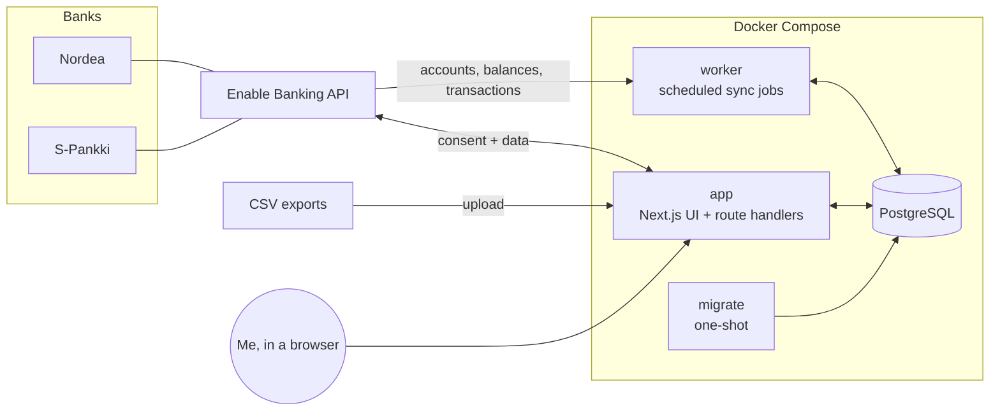
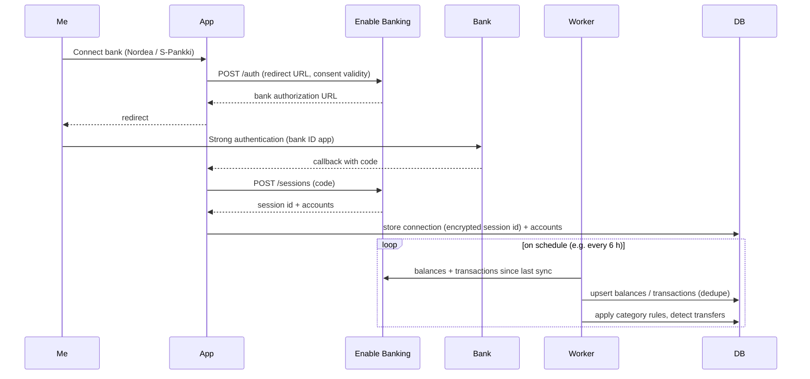

# Architecture

## Overview



| Service   | Role                                                                                                          |
| --------- | ------------------------------------------------------------------------------------------------------------- |
| `db`      | PostgreSQL 18. Data lives in the `pgdata` volume. The port is bound to `127.0.0.1` only.                      |
| `migrate` | Applies Drizzle migrations, then exits. `app` and `worker` start only after it succeeds.                      |
| `app`     | Next.js server: dashboard UI, the bank-connection flow (OAuth-style redirect), CSV upload, "sync now".        |
| `worker`  | Long-running Node process. It runs scheduled jobs with node-cron: bank sync, later price updates and backups. |

The app and the worker share the same code in `src/server`. The worker is not a separate codebase.

## Directory layout

```
src/
  app/                 Next.js App Router: pages, layouts, route handlers (UI + HTTP)
    (app)/             Route group: every page inside the app shell (layout.tsx renders
                       AppShell); Dashboard, reports/, connections/,
                       transactions/ (list, URL filters, inline category, details sheet,
                       edit Server Actions), settings/ (index) + settings/categories/
                       (categories, rules, re-apply; the shared rule form and actions),
                       import/ (CSV upload: page, preview/import Server Actions, form)
    login/             Login page (outside the shell, public)
    api/health/        Health check (DB connectivity, public)
  proxy.ts             Optimistic auth check: no session → /login (401 under /api)
  components/          React components (app only, never imported by src/server)
    app-shell/         Header, sidebar navigation, mobile menu (sheet)
    ui/                shadcn/ui primitives (generated by the shadcn CLI, Radix based)
    empty-state.tsx    Placeholder for pages without data yet
    form-controls.tsx  Native select and textarea styled like the shadcn input
  lib/                 App helpers: cn() (utils.ts), the navigation items, fi-FI
                       money and day formatting for display (format.ts)
    auth/              Server-only (next/headers): session data access layer
                       (session.ts: verifySession()), login/logout Server Actions;
                       routes.ts: public paths and the proxy's accessDecision()
  server/              Server-side domain code, shared by app and worker
    env.ts             Typed, validated environment variables (zod; getAuthEnv() for
                       the login secrets, which only the app needs; getEncryptionEnv()
                       for ENCRYPTION_KEY)
    crypto.ts          encryptSecret()/decryptSecret(): AES-256-GCM for stored
                       provider session ids, versioned `v1:` format
    auth/              Password hashing (argon2id), session sealing and re-issue
                       (iron-session), login check with backoff, `pnpm auth:hash` CLI
    db/
      client.ts        Drizzle client (postgres.js pool), lazily created
      schema/          Table definitions, one file per domain area (banking, categories,
                       transactions, sync; shared column builders in columns.ts)
      migrations.ts    applyMigrations(): shared by migrate.ts and the L2 tests
      migrate.ts       Migration runner (used by the `migrate` service and pnpm db:migrate)
    dedupe-hash.ts     Fallback identity of a transaction (normalised date, amount, text)
    providers/         FinancialProvider contract: types.ts (interface, DTOs, ids),
                       errors.ts (typed errors, HTTP status mapping), registry.ts
                       (id → implementation, BANK_PROVIDER), fake.ts (deterministic
                       in-memory bank for tests and e2e), paging.ts (follows
                       transaction pages)
      enable-banking/  Enable Banking client and provider                (FIN-006)
    csv/               CSV import (F-012): parse.ts (RFC 4180 reader), values.ts
                       (decoding, amounts, dates), bank-csv.ts (Nordea, S-Pankki and
                       generic layouts), import-csv.ts (write rows, manual accounts)
    sync/              Sync orchestration: runs.ts (shared `sync_runs` bookkeeping),
                       sync-balances.ts (accounts + balance snapshots, F-008),
                       balance-types.ts (display balance type), sync-transactions.ts
                       + transaction-merge.ts (transactions, F-009)
    categorization/    Categorisation (F-014): rules.ts (rule matcher), transfers.ts
                       (own-transfer pairing), categorize.ts (the sync/import hook,
                       reapplyRules()), defaults.ts + seed.ts (default categories
                       and Finnish merchant rules, seeded by migrate.ts); F-015:
                       manage.ts (categories and rules: list, create, rename,
                       delete, reorder), rule-input.ts (checks a rule the user
                       enters), transaction-edits.ts (inline category, note,
                       mark / unlink transfer)
    queries/           Read models: transaction-filter.ts (the /transactions URL
                       filters, pure), transactions.ts (filtered page + totals,
                       F-015); the dashboard's come with FIN-016+
  worker/
    index.ts           Worker entrypoint: registers jobs, graceful shutdown
    jobs.ts            Job registry (name, cron schedule, run function)
tests/
  unit/                Vitest unit project (L1)
  integration/         Vitest + Testcontainers Postgres 18 (L2); helpers/postgres.ts
  e2e/                 Playwright against the built app (L3); support/server.ts is the
                       webServer (Testcontainers Postgres + build + standalone server);
                       the run fails if the app server logs an error line
                       (support/server-errors.ts), even when every test passed; the
                       server seeds the default categories and rules like db:migrate,
                       and support/fixtures.ts (a pending transaction, own account)
  fixtures/            Synthetic or anonymised fixtures only, never real data
                       (csv/: synthetic Nordea, S-Pankki and generic exports)
drizzle/               Generated SQL migrations (committed)
secrets/               Private keys (gitignored), mounted into containers
.claude/               Claude Code permissions and the harness plugin pin (hooks, skills and the
                       evaluator come from the shared harness; project rules in harness.config.json)
docs/                  Plan, architecture, tech stack, tickets, decisions, harness docs
```

Folders marked with a ticket number don't exist yet. They are created by that ticket.

## Data flow: bank sync



## Data model

The core tables (F-002, `src/server/db/schema/`, first migration `drizzle/0000_init.sql`; F-009 added `accounts.transactions_synced_at` and `transactions.note` in `0001_sync_transactions.sql`; F-014 the rule amount conditions in `0002_categorization_rules.sql`). Amounts are stored as **integer minor units** (cents, `bigint`, read as a JS `number`) together with an ISO-4217 `char(3)` currency code. Floats are never used for money. Every id is a `uuid`; every point in time is `timestamptz`; calendar days (`booking_date`, `value_date`, snapshot `date`) are `date`. Every table has `created_at` / `updated_at`.

| Table               | Purpose                                   | Key columns                                                                                                                                                                                                                 |
| ------------------- | ----------------------------------------- | --------------------------------------------------------------------------------------------------------------------------------------------------------------------------------------------------------------------------- |
| `institutions`      | Banks, brokers, exchanges                 | `id`, `name`, `country`, `provider` (`enable_banking`, `csv`, …), `provider_ref`                                                                                                                                            |
| `connections`       | One authorized link to an institution     | `id`, `institution_id`, `provider`, `session_ref` (encrypted), `status`, `consent_expires_at`, `last_synced_at`                                                                                                             |
| `accounts`          | Any account that holds value              | `id`, `connection_id?`, `institution_id`, `type` (`checking`, `savings`, `brokerage`, `crypto`), `name`, `iban?`, `currency`, `provider_account_ref`, `archived`, `transactions_synced_at?`                                 |
| `balance_snapshots` | Balance history (one per account per day) | `account_id`, `date`, `amount_minor`, `currency`, `balance_type`                                                                                                                                                            |
| `transactions`      | Booked and pending transactions           | `id`, `account_id`, `provider_txn_ref?`, `dedupe_hash`, `booking_date`, `value_date`, `amount_minor`, `currency`, `counterparty`, `description`, `status`, `category_id?`, `category_source`, `note?`, `transfer_group_id?` |
| `categories`        | Spending/income categories (hierarchical) | `id`, `name`, `parent_id?`, `kind` (`expense`, `income`, `transfer`), `color`                                                                                                                                               |
| `category_rules`    | Auto-categorization rules                 | `id`, `category_id`, `match_field`, `match_type`, `pattern`, `priority`, `amount_sign?`, `amount_min_minor?`, `amount_max_minor?`                                                                                           |
| `sync_runs`         | Sync log                                  | `id`, `connection_id`, `started_at`, `finished_at`, `status`, `error`, counts                                                                                                                                               |

Enums: `account_type` (`checking`, `savings`, `brokerage`, `crypto`), `connection_status` (`active`, `expired`, `revoked`, `archived`), `transaction_status` (`booked`, `pending`), `category_source` (`none`, `rule`, `manual`), `category_kind` (`expense`, `income`, `transfer`), `rule_match_field` (`counterparty`, `description`), `rule_match_type` (`contains`, `equals`, `regex`), `rule_amount_sign` (`debit`, `credit`), `sync_status` (`running`, `succeeded`, `failed`). `provider` columns are open text so a new provider needs no migration; `balance_type` holds the provider's ISO 20022 code (`CLBD`, `ITAV`, …).

Idempotency constraints (syncs and imports upsert on them):

- `transactions`: unique `(account_id, provider_txn_ref)` (NULL refs never collide) and unique `(account_id, dedupe_hash)`, where `dedupe_hash` is `dedupeHash()` from `src/server/dedupe-hash.ts`: SHA-256 of the normalised booking date, amount, counterparty and description (plus an occurrence number from the second of otherwise identical transactions in one listing on). Indexes on `(account_id, booking_date)`, `category_id` and `transfer_group_id`.
- `balance_snapshots`: unique `(account_id, date, balance_type)`.
- `categories`: unique `(parent_id, name)` with `NULLS NOT DISTINCT`, so seeded top-level names are unique too; `institutions`: unique `(provider, provider_ref)`.

Planned investment tables (FIN-019): `assets` (ticker or coin, asset class), `holdings` (account + asset + quantity), `investment_transactions` (buy, sell, dividend) and `prices` (asset, date, price). Brokerage and crypto accounts reuse `accounts`, so net worth is a single query across every account type.

## Provider abstraction

Every data source implements one interface (`src/server/providers/types.ts`, F-005, D-008):

```ts
interface FinancialProvider {
  readonly id: ProviderId; // "enable_banking" | "csv" | "fake"; later "kraken", ...
  listAccounts(connection: ProviderConnection): Promise<ProviderAccount[]>;
  getBalances(
    connection: ProviderConnection,
    account: ProviderAccountRef,
  ): Promise<ProviderBalance[]>;
  getTransactions(
    connection: ProviderConnection,
    account: ProviderAccountRef,
    range: { from?: IsoDate; to?: IsoDate }, // inclusive days; no `from` = oldest available
    continuationKey?: string, // from the previous page
  ): Promise<{ transactions: ProviderTransaction[]; continuationKey: string | null }>;
  getHoldings?(…): Promise<ProviderHolding[]>; // investment providers (F-019)
}
```

Providers return **normalized** DTOs whose fields mirror the table columns: amounts in signed integer minor units plus an ISO-4217 currency, calendar days as `YYYY-MM-DD` strings, the provider's own ids as `ref` (`provider_account_ref`, `provider_txn_ref`, nullable for transactions), balances with their ISO 20022 `balanceType`. Mapping from provider-specific JSON happens inside the provider, and the sync layer only ever sees normalized data. `ProviderConnection` carries the **decrypted** session id; the caller decrypts `connections.session_ref` with `decryptSecret()`.

- **Errors.** The failures the sync layer handles are typed (`errors.ts`): `ProviderAuthError` (session or consent expired → reconnect), `ProviderRateLimitError` (with `retryAfterMs` when known) and `ProviderUnavailableError` (provider or bank down → retry later), all `ProviderError`s with a `kind` and the `providerId`. HTTP clients map responses with `providerErrorFromStatus()`: 401/403 → auth, 429 → rate limit (parses `Retry-After`), 408/5xx → unavailable, anything else stays a bug.
- **Registry.** `registry.ts` maps the id stored in `provider` columns to its implementation (`getProvider(id)`, `UnknownProviderError` otherwise); `getBankProvider()` returns the one `BANK_PROVIDER` selects for new bank connections (`enable_banking` by default, registered by F-006).
- **Fake provider.** `BANK_PROVIDER=fake` registers `createFakeProvider()`: two synthetic EUR accounts (`fake-checking`, `fake-savings`, open since 2025-01-01) whose transactions are a pure function of the account and the day (monthly rent, salary and savings transfer plus hashed card purchases), so every range, call and process sees the same data; balances (`CLBD` yesterday, `ITAV` today including today's pending transactions) equal the opening balance plus that history. Only "today" comes from the clock (`now` option), as a UTC date, so between 00:00 and 03:00 Helsinki time the fake's today (and its pending day) is the previous local day; tests that compare against the app's local day should inject `now`. Transaction listings come in pages of 100 (`transactionPageSize` option; the continuation key is the offset). The session refs `fake:expired`, `fake:rate-limited` and `fake:unavailable` make every call fail with the matching typed error. The L3 server runs with `BANK_PROVIDER=fake`; without it the fake is not registered, so a real installation never serves fake data.

## Balance sync

`syncBalances(connectionId)` (`src/server/sync/sync-balances.ts`, F-008, D-009) syncs one connection's accounts and balances:

- It writes one `sync_runs` row per call (`running` → `succeeded`/`failed`, `accounts_count` = accounts listed, `fetched_count` = balances returned, `inserted_count`/`updated_count` = snapshots added or changed) and, on success, sets `connections.last_synced_at`.
- It fetches everything first (`listAccounts`, then `getBalances` per account, one request at a time) and writes in one transaction, so a provider failure halfway leaves the stored data unchanged.
- Accounts are matched by `(connection_id, provider_account_ref)`: new ones are added under the connection's institution, known ones updated, archived ones the provider lists again restored, and the connection's accounts it no longer lists are archived with their history kept. Accounts of other connections and manual accounts are never touched.
- Snapshots upsert on `(account_id, date, balance_type)` with the day the provider reports for the balance; a same-day re-sync overwrites the amount, an unchanged one is not rewritten.
- A `ProviderError` is recorded on the run and returned (`status: "failed"`, `errorKind`, `retryAfterMs`), never thrown; `auth_expired` (or a connection without a session) also sets the connection to `expired`. A connection that is not `active` gets a failed run (`not_active`) without a provider call. Any other error (wrong `ENCRYPTION_KEY`, unknown provider, database failure) fails the run and is rethrown. Two syncs of one connection must not overlap; F-010's advisory lock ensures that.
- Which balance type a view shows is `pickDisplayBalance()` in `balance-types.ts`: `ITAV`, `CLAV`, `ITBD`, `CLBD`, `XPCD`, `OPAV`, `OPBD` by default, with per-bank overrides keyed by `institutions.provider_ref` (empty until the F-001 findings).

## Transaction sync

`syncTransactions(connectionId)` (`src/server/sync/sync-transactions.ts`, F-009, D-010) syncs the transactions of a connection's accounts, as `syncBalances()` last stored them (non-archived, with a provider ref; ordered by ref):

- One `sync_runs` row per call, like the balance sync (`accounts_count` = accounts synced, `fetched_count` = transactions listed over all pages, `inserted_count`, `updated_count`); the result also counts `removed` stale pending ones. On success it sets `connections.last_synced_at`. Not-`active` connections, provider errors (auth → `expired`) and bugs are handled by the shared `runs.ts` exactly as in the balance sync.
- Window per account: never synced (`accounts.transactions_synced_at` null) → no `from`, the provider's oldest available day (backfill); otherwise the `APP_TIMEZONE` day of `transactions_synced_at` minus 7 days, or the account's oldest stored pending transaction if that is older. `to` is the provider's today. `fetchAllTransactions()` (`providers/paging.ts`) follows `continuationKey` page by page and stops a provider that repeats a key or passes 1000 pages.
- Each account is fetched completely, then merged and written in its own database transaction together with its `transactions_synced_at` (= when its fetch started). A provider error stops the run: accounts already written stay, the failed account and the rest are untouched, and the run records the counts so far, so the next sync continues where this one stopped.
- Merge (`transaction-merge.ts`, pure): `identifyTransactions()` keeps the last version of a repeated ref and numbers otherwise identical transactions (`dedupeHash({ …, occurrence })`, ref order first) so two equal coffees on one day are two rows. `mergeTransactions()` matches each fetched transaction to a stored one by `provider_txn_ref`, then `dedupe_hash`, then to a pending one with the same amount and currency at most 7 days away (same counterparty first, then the nearest day), which is how a pending transaction becomes its booked version even with a new id, date or text. Matches are updated in place (only if something changed), so the row id, `category_id`, `category_source`, `note` and `transfer_group_id` survive; a sync never writes those columns. Unmatched ones are inserted; stored pending ones that nothing matched are deleted; booked ones the listing lacks are kept. Updates that change a ref or hash first move to a placeholder key, because Postgres checks unique keys row by row.
- After writing, the `categorize` hook runs in the same database transaction with the ids of the inserted and updated transactions; the default is the rule engine (`categorizeTransactions`, F-014), so a pending transaction is categorised again when it is booked.

## CSV import

`/import` (F-012, D-011) reads a netbank CSV export and writes its rows into an account; the server keeps no upload state, so the preview and the import Server Actions both receive the file (at most 4 MB).

- **Reading** (`src/server/csv/bank-csv.ts`, `readBankCsv()`): UTF-8 or else Windows-1252; delimiter `;`, tab or `,`; the Nordea and S-Pankki layouts are found by their Finnish header names (so column order and preamble lines above the header may vary), anything else is read with a chosen date, amount, counterparty and description column (guessed from common names). Amounts with a decimal comma and space groups become integer minor units, `d.m.yyyy` dates `YYYY-MM-DD`. A row that cannot be read is an error with its file line; the rest are still read.
- **Writing** (`import-csv.ts`, `importCsvRows()`): rows become booked transactions without a ref, numbered by the sync's `identifyTransactions()` (identical rows get occurrence numbers in their hash) and inserted with `ON CONFLICT (account_id, dedupe_hash) DO NOTHING`, in one database transaction with the `categorize` hook (the rule engine by default, F-014). So a row already stored by an earlier import or by the bank sync (with the same texts) is skipped as a duplicate, and a later bank sync adopts imported rows by hash instead of adding them again. An import never changes, books or deletes a stored row. The summary counts rows read, inserted, skipped as duplicates and errors (with row numbers; a currency other than the account's is an error too).
- **Accounts**: any non-archived account, or a new manual one (`connection_id` null, EUR, checking or savings) under the `csv` institution of the export's format (`provider_ref` `nordea`, `s-pankki` or `generic`), created in the same database transaction as its rows (`importCsvIntoNewAccount()`). Imports write no `sync_runs` row.

## Categorization

`src/server/categorization/` (F-014, D-012) gives transactions a category and links own transfers. It runs as the default `categorize` hook of `syncTransactions()` and `importCsvRows()` (`categorizeTransactions(tx, ids)`, inside their write transaction) and over every transaction in `reapplyRules()`.

- **Seeds** (`defaults.ts`, `seed.ts`): `pnpm db:migrate` (and the Compose `migrate` service) runs `seedDefaults()` after the migrations. Into an empty `categories` table it writes two-level defaults (Housing, Groceries, Restaurants & cafés, Transport, Shopping, Health, Subscriptions, Travel, Entertainment, Income, Savings & investments, Transfers, Uncategorized, most with subcategories) and 100 rules for common Finnish merchants (S-Market, Prisma, K-Market, Lidl, Alepa, HSL, VR, Wolt, Foodora, …) at priorities 100, 110, …; a table with any category is left alone, so the user's deletions stick. `Income` has kind `income`; `Transfers` and `Savings & investments` have kind `transfer` (not spending, not income); the rest `expense`.
- **Rules** (`rules.ts`, pure): a rule matches `counterparty` or `description` with `contains` / `equals` (case-insensitive, whitespace collapsed) or `regex` (JavaScript, `i` flag; an invalid pattern never matches), optionally only `debit`s or `credit`s and an inclusive range on the absolute amount (`amount_min_minor`, `amount_max_minor`). Rules run by `priority` (lower first), then creation time, then id; the first match wins.
- **Applying**: transactions with `category_source = 'manual'` are never touched. Transactions in a transfer group keep Transfers. Every other one in scope gets its first matching rule's category (`rule`), or no category and `none` when nothing matches (so a changed or deleted rule also un-categorises on re-apply). Uncategorized is a category for manual picks and reports, not something the engine assigns.
- **Transfers** (`transfers.ts`, pure; `categorize.ts` loads the candidates): booked, non-manual transactions in no group (or the only member of one) are paired when a debit and a credit of the same absolute amount and currency sit on two different own accounts at most 3 days apart. A transaction whose counterparty or description contains another own account's IBAN (spaces and case ignored) is a transfer to that account: it pairs only with a leg there, and is a one-sided transfer (its own group) until that leg shows up, which then joins the group. Without an IBAN, a leg that a rule put in any category other than Transfers never pairs, so a grocery purchase does not pair with an equal payment from a friend. Pairs closest in days are taken first. Both legs get one `transfer_group_id`, the top-level Transfers category (created if missing) and source `rule`; reports leave kind `transfer` out of spending and income. Pending transactions are not paired until booked.
- `reapplyRules()` runs both steps over all transactions in one database transaction and returns how many changed category and how many were linked; existing transfer groups are kept (unlinking is a user edit, below).

## Transactions view and category management

`/transactions` and `/settings/categories` (F-015, D-013) are Server Components that read through `src/server/queries/` and `src/server/categorization/manage.ts`, with client components for the forms and Server Actions (each calls `verifySession()` and `refresh()`) for every change.

- **Filters** are only in the URL: `from`, `to` (booking days), `account` (repeated), `category` (an id, its subcategories included, or `none`), `q` (counterparty, description or note), `type` (`income` / `expense`), `transfers` (`exclude` / `only`) and `page`. `transaction-filter.ts` parses them (invalid values are ignored) and writes them back (`transactionsHref()`); the filter form navigates to the URL of the fields that are set.
- **Pages** of 50 rows, LIMIT/OFFSET ordered by booking day, creation time and id; the totals (count, income, expenses, net per currency) are one aggregate over the whole filter. A page past the end shows the last one.
- **Edits** (`transaction-edits.ts`) are `manual`, so the engine never undoes them: the inline category; "Automatic (rules)" hands a transaction back to the rules (a transfer leg gets Transfers); a note; "Mark as transfer" makes a one-sided transfer (own group, Transfers); "Unlink transfer" takes every leg out of its group with its rule category (or none).
- **Rules**: a new rule runs before all others (priority = lowest − 10); "apply to similar past ones" is `reapplyRules()`. Moving a rule places it before or after another (the settings page can list one category's rules) and renumbers all rules 10, 20, …; creating and moving take an advisory lock. Regex patterns are compiled before saving (`rule-input.ts`).
- **Categories**: two levels, a subcategory has its parent's kind; deleting one deletes its subcategories and their rules and returns its transactions to no category (`none`; transfer legs get Transfers). The top-level Transfers category cannot be renamed or deleted.
- **Concurrency**: categorisation runs under one transaction-scoped advisory lock (`lockCategorization()` in `categorize.ts`), which the sync takes at the start of each account's write transaction and every user edit of a category or transfer group takes first; the engine's updates re-check that a row is not `manual`, so a concurrent user edit wins.

## Conventions

- **Server code boundary.** Everything under `src/server` must run in plain Node, because the worker imports it. Don't import Next-only modules there (`next/headers`, `server-only`, and so on). Next-specific data access belongs in `src/app` or in `src/server/queries` files that only the app imports.
- **Environment.** Read the environment only through `getEnv()` from `src/server/env.ts`. Add new variables to its zod schema and to `.env.example`. Variables only the web app needs (the login secrets) are in a second schema read by `getAuthEnv()`, so the worker runs without them; `ENCRYPTION_KEY` has a third (`getEncryptionEnv()`, read on the first encryption), so the migrate job and `/api/health` run without it.
- **DB access.** Use `getDb()`. It is created lazily, so `next build` works without a database.
- **UI.** Pages that belong to the app go into `src/app/(app)/` and get the shell from its layout; a page that must not show it (e.g. login) lives outside the group. Components come from shadcn/ui (`pnpm dlx shadcn@latest add <name>` writes them to `src/components/ui`); a new navigation section is one entry in `NAV_ITEMS` (`src/lib/navigation.ts`). Next 16 keeps visited pages mounted but hidden, so e2e locators that are not role based (e.g. `getByTestId`) need `.filter({ visible: true })`.
- **Cache Components** are enabled (`cacheComponents: true`). Anything reading cookies or DB data at request time must sit behind `<Suspense>` or call `connection()`. See `node_modules/next/dist/docs/` for Next 16 specifics.
- **Time zone.** Dates are stored in UTC. Calendar grouping (months, days) uses `APP_TIMEZONE` (`Europe/Helsinki`).

## Security

- Single-user login protects every page and route except `/login` and `/api/health` (FIN-004, D-007), even though the app runs locally. `AUTH_PASSWORD_HASH` holds an argon2id hash of the one password (`pnpm auth:hash`). A login sets `pf_session`: an iron-session seal (`SESSION_SECRET`) of the issue time, `httpOnly`, `sameSite=lax`, `secure` in production, valid 30 days and re-issued by the proxy once a day (not on Server Action calls, which may change the cookie themselves: logout deletes it), so it expires 30 days after the last visit. Sessions are stateless: logout deletes the cookie, rotating `SESSION_SECRET` signs out every browser. After 5 consecutive wrong passwords each attempt waits 1 s, 2 s, 4 s, … (at most 15 min) after the last failure; the counter is in memory and global, so a persistent attacker who can reach the app could keep the owner locked out (accepted: the app is bound to `127.0.0.1`; a restart clears it). `/api/health` is answered before the session check, so it works even when the login secrets are missing.
- `src/proxy.ts` only redirects optimistically. Server Components, Server Actions and Route Handlers that touch data call `verifySession()` (`src/lib/auth/session.ts`) themselves; a Server Action is a POST to its page and must never rely on the proxy matcher. `getSession()` awaits `io()` (`next/cache`) before it checks the expiry, because with Cache Components a clock read after `cookies()` still counts as prerendering in the runtime prefetch (`Date.now()` → logged `blocking-prerender-current-time` error); other request-time code that reads the clock needs the same.
- The Enable Banking private key lives in `./secrets/` (gitignored) and is mounted read-only.
- Session and consent identifiers are encrypted at rest with AES-256-GCM, using `ENCRYPTION_KEY` (32 random bytes, base64): `encryptSecret()` / `decryptSecret()` in `src/server/crypto.ts` write `v1:<iv>:<ciphertext>:<tag>` (base64url, fresh 12-byte IV, 16-byte tag, the version authenticated as additional data) and reject tampered values, the wrong key and non-canonical encodings with `DecryptionError`. Losing the key means reconnecting the banks; rotating it needs a re-encryption step (a future `v2` or key id, not built yet).
- The database and app ports are bound to `127.0.0.1`.
- The integration is read-only (account information only). The app never initiates payments.
