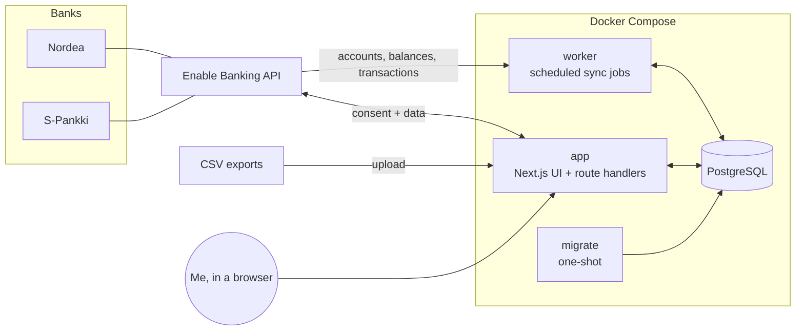
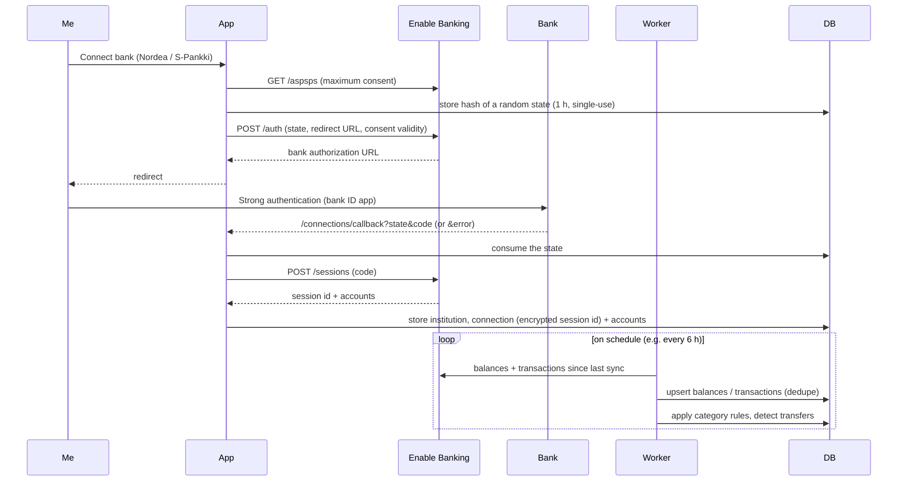

# Architecture

## Overview



| Service   | Role                                                                                                          |
| --------- | ------------------------------------------------------------------------------------------------------------- |
| `db`      | PostgreSQL 18. Data lives in the `pgdata` volume. The port is bound to `127.0.0.1` only.                      |
| `migrate` | Applies Drizzle migrations, then exits. `app` and `worker` start only after it succeeds.                      |
| `app`     | Next.js server: dashboard UI, the bank-connection flow (OAuth-style redirect), CSV upload, "sync now".        |
| `worker`  | Long-running Node process. It runs scheduled jobs with node-cron: price updates, later bank sync and backups. |

The app and the worker share the same code in `src/server`. The worker is not a separate codebase.

## Directory layout

```
src/
  app/                 Next.js App Router: pages, layouts, route handlers (UI + HTTP)
    (app)/             Route group: every page inside the app shell (layout.tsx renders
                       AppShell); Dashboard (page.tsx: overview, F-016),
                       transactions/ (list, URL filters, inline category, details sheet,
                       edit Server Actions; F-015),
                       reports/ (spending/, cash-flow/; F-017; balances/, F-018),
                       connections/ (list, connect form, account and connection
                       Server Actions, callback/route.ts for the bank's redirect,
                       fake-bank/ for BANK_PROVIDER=fake; F-007),
                       settings/ (index) + settings/categories/ (categories, rules,
                       re-apply; the shared rule form and actions; F-015),
                       import/ (CSV upload: page, preview/import Server Actions, form),
                       investments/ (holdings table, Nordnet import action and form; F-020;
                       manual crypto holding action and form, F-021)
    login/             Login page (outside the shell, public)
    api/health/        Health check (DB connectivity, public)
  proxy.ts             Optimistic auth check: no session → /login (401 under /api)
  components/          React components (app only, never imported by src/server)
    app-shell/         Header, sidebar navigation, mobile menu (sheet)
    ui/                shadcn/ui primitives (generated by the shadcn CLI, Radix based)
    dashboard/         Dashboard overview: stat tiles, accounts by bank, connection
                       status, the Recharts balance sparkline (a client component), this
                       month's income, expenses and net
    reports/           Spending and cash-flow reports (F-017): period selector, category
                       table, comparison tiles, top merchants, transaction list; the
                       Recharts stacked bar and cash-flow charts are client components;
                       the balance history's net-worth line and stacked account areas
                       (balance-history-chart.tsx, F-018); the allocation bars
                       (allocation-breakdown.tsx) and the performance lines
                       (performance-chart.tsx, a client component, F-022)
    investments/       The /investments holdings table (F-020; crypto, F-021)
    empty-state.tsx    Placeholder for pages without data yet
    form-controls.tsx  Native select and textarea styled like the shadcn input
  lib/                 App helpers: cn() (utils.ts), the navigation items, fi-FI
                       money, change, percent, day, month and time formatting for
                       display (format.ts), report URLs and labels (reports.ts)
    auth/              Server-only (next/headers): session data access layer
                       (session.ts: verifySession()), login/logout Server Actions;
                       routes.ts: public paths and the proxy's accessDecision()
  server/              Server-side domain code, shared by app and worker
    env.ts             Typed, validated environment variables (zod; getAuthEnv() for
                       the login secrets, which only the app needs; getEncryptionEnv()
                       for ENCRYPTION_KEY)
    crypto.ts          encryptSecret()/decryptSecret(): AES-256-GCM for stored
                       provider session ids, versioned `v1:` format
    auth/              Password hashing (argon2id), session sealing and re-issue
                       (iron-session), login check with backoff, `pnpm auth:hash` CLI
    db/
      client.ts        Drizzle client (postgres.js pool), lazily created
      schema/          Table definitions, one file per domain area (banking, categories,
                       transactions, sync, investments; shared column builders in columns.ts)
      migrations.ts    applyMigrations(): shared by migrate.ts and the L2 tests
      migrate.ts       Migration runner (used by the `migrate` service and pnpm db:migrate)
    dates.ts           Calendar-day helpers: addDays(), dayNumber(), localDate()
    dedupe-hash.ts     Fallback identity of a transaction (normalised date, amount, text)
    providers/         FinancialProvider contract: types.ts (interface, DTOs, ids),
                       errors.ts (typed errors, HTTP status mapping), registry.ts
                       (id → implementation, BANK_PROVIDER), fake.ts (deterministic
                       in-memory bank for tests and e2e), paging.ts (follows
                       transaction pages)
      enable-banking/  Enable Banking (F-006): client.ts (JWT, requests, retries, error
                       mapping), schemas.ts (zod response schemas), provider.ts
                       (FinancialProvider, DTO mapping, authorisation helpers)
    connections/       Connect-bank flow (F-007): authorization.ts (state, start,
                       callback), manage.ts (list, rename, remove, archive),
                       account-input.ts (what the user may set, no imports)
    csv/               CSV import (F-012): parse.ts (RFC 4180 reader), values.ts
                       (decoding, amounts, dates), bank-csv.ts (Nordea, S-Pankki and
                       generic layouts), import-csv.ts (write rows, manual accounts)
    sync/              Sync orchestration: runs.ts (shared `sync_runs` bookkeeping),
                       sync-balances.ts (accounts + balance snapshots, F-008),
                       balance-types.ts (display balance type), sync-transactions.ts
                       + transaction-merge.ts (transactions, F-009)
    categorization/    Categorisation (F-014): rules.ts (rule matcher), transfers.ts
                       (own-transfer pairing), categorize.ts (the sync/import hook,
                       reapplyRules()), defaults.ts + seed.ts (default categories
                       and Finnish merchant rules, seeded by migrate.ts); F-015:
                       manage.ts (categories and rules: list, create, rename,
                       delete, reorder), rule-input.ts (checks a rule the user
                       enters), transaction-edits.ts (inline category, note,
                       mark / unlink transfer)
    queries/           Read models: transaction-filter.ts (the /transactions URL
                       filters, pure), transactions.ts (filtered page + totals,
                       F-015); for the dashboard: balances.ts (balance on a day,
                       daily series), dashboard.ts (overview: totals, accounts by bank,
                       connection health; F-016, holdings in net worth F-020), reports.ts (spending, cash flow and
                       the month tiles; F-017), balance-history.ts (daily balances and
                       net worth over a range; F-018), investments.ts (an account's
                       EUR holdings value on a day, F-019; the /investments holdings
                       with gain and weight, F-020), investment-history.ts (the rows
                       behind brokerage and crypto accounts' daily values) and
                       portfolio.ts (allocation and performance; F-022)
    investments/       Investment valuation (F-019): decimal.ts (exact BigInt fixed-point
                       decimals, currency minor-unit digits), valuation.ts (Σ quantity ×
                       price × FX with last-known fallbacks); F-020: nordnet-csv.ts
                       (Nordnet export reader), import-nordnet.ts (accounts, assets,
                       deduped transactions, trade prices), holdings.ts (derived
                       holdings, average cost), price-client.ts (Twelve Data with the
                       free-tier limiter), ecb.ts (ECB reference rates),
                       update-prices.ts (the daily price-update job); F-021: coins.ts
                       (known coins' CoinGecko ids), coingecko.ts (crypto prices),
                       assets.ts (asset matching), sync-kraken.ts (the Kraken
                       connection and sync), manual-holdings.ts (wallets without an API);
                       F-022: valuation-series.ts (daily holdings values, derived
                       cash, external flows), performance.ts (contributions vs
                       market gain)
    reports/           Pure report helpers (F-017): period.ts (presets, custom ranges,
                       previous period, average window), merchant-name.ts (normalised
                       merchant names), balance-series.ts (balance ranges, carried and
                       reconstructed daily balances; F-018)
  worker/
    index.ts           Worker entrypoint: registers jobs, graceful shutdown
    jobs.ts            Job registry (name, cron schedule, run function): heartbeat,
                       price-update (daily 07:30, F-020), kraken-sync (every 6 h, F-021)
tests/
  unit/                Vitest unit project (L1)
  integration/         Vitest + Testcontainers Postgres 18 (L2); helpers/postgres.ts
  e2e/                 Playwright against the built app (L3); support/server.ts is the
                       webServer (Testcontainers Postgres + build + standalone server),
                       support/database.ts lets specs seed that database directly
                       (dashboard.spec.ts, then reports.spec.ts, run as their own
                       projects before the others);
                       the run fails if the app server logs an error line
                       (support/server-errors.ts), even when every test passed; the
                       server seeds the default categories and rules like db:migrate
                       (no accounts); support/fixtures.ts holds rows a spec seeds (a
                       pending transaction in its own account)
  fixtures/            Synthetic or anonymised fixtures only, never real data
                       (csv/: synthetic Nordea, S-Pankki and generic exports;
                       nordnet/: a synthetic UTF-16 Nordnet transaction export;
                       kraken/: synthetic BalanceEx and Ledgers responses)
drizzle/               Generated SQL migrations (committed)
secrets/               Private keys (gitignored), mounted into containers
.claude/               Claude Code permissions and the harness plugin pin (hooks, skills and the
                       evaluator come from the shared harness; project rules in harness.config.json)
docs/                  Plan, architecture, tech stack, tickets, decisions, harness docs
```

Folders marked with a ticket number don't exist yet. They are created by that ticket.

## Data flow: bank sync



## Data model

The core tables (F-002, `src/server/db/schema/`, first migration `drizzle/0000_init.sql`; F-009 added `accounts.transactions_synced_at` and `transactions.note` in `0001_sync_transactions.sql`; F-014 the rule amount conditions in `0002_categorization_rules.sql`; F-019 the investment tables in `0003_investments.sql`; F-007 `bank_authorizations` in `0004_connect_bank.sql`). Amounts are stored as **integer minor units** (cents, `bigint`, read as a JS `number`) together with an ISO-4217 `char(3)` currency code. Floats are never used for money. Every id is a `uuid`; every point in time is `timestamptz`; calendar days (`booking_date`, `value_date`, snapshot `date`) are `date`. Every table has `created_at` / `updated_at`.

| Table                 | Purpose                                   | Key columns                                                                                                                                                                                                                 |
| --------------------- | ----------------------------------------- | --------------------------------------------------------------------------------------------------------------------------------------------------------------------------------------------------------------------------- |
| `institutions`        | Banks, brokers, exchanges                 | `id`, `name`, `country`, `provider` (`enable_banking`, `csv`, …), `provider_ref`                                                                                                                                            |
| `connections`         | One authorized link to an institution     | `id`, `institution_id`, `provider`, `session_ref` (encrypted), `status`, `consent_expires_at`, `last_synced_at`                                                                                                             |
| `accounts`            | Any account that holds value              | `id`, `connection_id?`, `institution_id`, `type` (`checking`, `savings`, `brokerage`, `crypto`), `name`, `iban?`, `currency`, `provider_account_ref`, `archived`, `transactions_synced_at?`                                 |
| `balance_snapshots`   | Balance history (one per account per day) | `account_id`, `date`, `amount_minor`, `currency`, `balance_type`                                                                                                                                                            |
| `transactions`        | Booked and pending transactions           | `id`, `account_id`, `provider_txn_ref?`, `dedupe_hash`, `booking_date`, `value_date`, `amount_minor`, `currency`, `counterparty`, `description`, `status`, `category_id?`, `category_source`, `note?`, `transfer_group_id?` |
| `categories`          | Spending/income categories (hierarchical) | `id`, `name`, `parent_id?`, `kind` (`expense`, `income`, `transfer`), `color`                                                                                                                                               |
| `category_rules`      | Auto-categorization rules                 | `id`, `category_id`, `match_field`, `match_type`, `pattern`, `priority`, `amount_sign?`, `amount_min_minor?`, `amount_max_minor?`                                                                                           |
| `sync_runs`           | Sync log                                  | `id`, `connection_id`, `started_at`, `finished_at`, `status`, `error`, counts                                                                                                                                               |
| `bank_authorizations` | Started, unfinished bank authorisations   | `state_hash` (SHA-256 of the `state`, unique), `provider`, `aspsp_name`, `aspsp_country`, `expires_at`                                                                                                                      |

Enums: `account_type` (`checking`, `savings`, `brokerage`, `crypto`), `connection_status` (`active`, `expired`, `revoked`, `archived`), `transaction_status` (`booked`, `pending`), `category_source` (`none`, `rule`, `manual`), `category_kind` (`expense`, `income`, `transfer`), `rule_match_field` (`counterparty`, `description`), `rule_match_type` (`contains`, `equals`, `regex`), `rule_amount_sign` (`debit`, `credit`), `sync_status` (`running`, `succeeded`, `failed`). `provider` columns are open text so a new provider needs no migration; `balance_type` holds the provider's ISO 20022 code (`CLBD`, `ITAV`, …).

Idempotency constraints (syncs and imports upsert on them):

- `transactions`: unique `(account_id, provider_txn_ref)` (NULL refs never collide) and unique `(account_id, dedupe_hash)`, where `dedupe_hash` is `dedupeHash()` from `src/server/dedupe-hash.ts`: SHA-256 of the normalised booking date, amount, counterparty and description (plus an occurrence number from the second of otherwise identical transactions in one listing on). Indexes on `(account_id, booking_date)`, `category_id` and `transfer_group_id`.
- `balance_snapshots`: unique `(account_id, date, balance_type)`.
- `categories`: unique `(parent_id, name)` with `NULLS NOT DISTINCT`, so seeded top-level names are unique too; `institutions`: unique `(provider, provider_ref)`.

### Investments

The investment tables (F-019, `schema/investments.ts`, D-016). Brokerage and crypto accounts are ordinary `accounts` rows (type `brokerage` / `crypto`), so net worth is a single query across every account type; their cash stays in `balance_snapshots`.

| Table                     | Purpose                                             | Key columns                                                                                                                           |
| ------------------------- | --------------------------------------------------- | ------------------------------------------------------------------------------------------------------------------------------------- |
| `assets`                  | Securities and coins                                | `id`, `symbol`, `name?`, `isin?` (unique), `coingecko_id?` (unique), `asset_class`, `currency` (quote currency)                       |
| `holdings`                | Quantity snapshots (one per account, asset and day) | `account_id`, `asset_id`, `date`, `quantity` (≥ 0; 0 = sold out)                                                                      |
| `investment_transactions` | Buys, sells, dividends, fees, transfers             | `account_id`, `asset_id?`, `type`, `provider_txn_ref?`, `dedupe_hash`, `trade_date`, `quantity?` (signed), `amount_minor`, `currency` |
| `prices`                  | Daily closing prices (one per asset and day)        | `asset_id`, `date`, `price_minor`, `currency`, `source`                                                                               |
| `fx_rates`                | ECB reference rates (one per currency and day)      | `date`, `currency`, `rate` (units per 1 EUR, > 0)                                                                                     |

- **Decimals.** Quantities, unit prices and rates are `numeric(38, 18)` (18 decimals as crypto needs, 20 integer digits), read and written as strings and computed with BigInt fixed-point in `src/server/investments/decimal.ts`; they never pass through a JS number. Cash amounts (`investment_transactions.amount_minor`) are integer minor units like everywhere else. A unit price is a rate, not an amount, so `price_minor` is a decimal number of minor units (a fund share or a small coin costs less than a cent).
- **Enums.** `asset_class` (`stock`, `etf`, `fund`, `crypto`, `other`), `investment_transaction_type` (`buy`, `sell`, `dividend`, `fee`, `transfer`). A transaction's `quantity` is the signed change in units held, `amount_minor` the signed cash effect (− paid, + received); a cash-only row (deposit, account fee) has no asset.
- **Idempotency.** `holdings` unique `(account_id, asset_id, date)`; `investment_transactions` unique `(account_id, provider_txn_ref)` and `(account_id, dedupe_hash)` as `transactions`; `prices` unique `(asset_id, date)`; `fx_rates` unique `(date, currency)`. Deleting an account deletes its holdings and investment transactions; an asset in use cannot be deleted.
- **Valuation.** `getAccountValuation(accountId, date)` (`src/server/queries/investments.ts`) loads each asset's latest holding snapshot, price and exchange rate on or before the day and `valueHoldings()` (`src/server/investments/valuation.ts`) returns the EUR value as Σ quantity × price × FX: `q × p × 10^2 / (10^e(currency) × rate)`, exact until one half-away-from-zero rounding per position; the total is the sum of the rounded positions. A missing price or rate (weekend, holiday, failed fetch) falls back to the last known one; an asset with none at all is listed with `missing: "price"` / `"fx_rate"`, left out of the total and makes the valuation `complete: false`.

## Nordnet import and prices

`/investments` (F-020, D-017) lists the holdings of every non-archived brokerage and crypto account and imports Nordnet transaction exports (Sivuni → Tapahtumat ja laskelmat → Vie CSV-tiedostoon) with the `importNordnet` Server Action (at most 4 MB, no preview: the import is idempotent).

- **Reading** (`readNordnetCsv()`): UTF-16 (byte order mark), UTF-8 or Windows-1252; tab, `;` or `,`; columns by Finnish, English or Swedish header name, the header may sit below preamble lines; a `Valuutta` column belongs to the value column before it (the amount's currency follows `Summa`, the price's `Kurssi` or `Kokonaiskulut`). Decimal commas (with both a comma and a point, the last is the decimal separator); trade date (`Kauppapäivä`, else `Kirjauspäivä`). Types become `buy` (`OSTO`, `MERKINTÄ`), `sell` (`MYYNTI`, `LUNASTUS`), `dividend` (`OSINKO`, positive interest), `transfer` (`TALLETUS`, `NOSTO`, cash only) or `fee` (fees, withholding taxes, negative and loan interest); signs follow the type. Currency exchanges and cancelled rows are "not recorded"; unknown types and unreadable cells are errors with the file line.
- **Writing** (`importNordnetCsv()`, one database transaction): each `Salkku` is a brokerage account (`provider_account_ref` = the portfolio, EUR) under the `csv` institution `nordnet`, created on first use; assets match by ISIN, else symbol and currency, and take their quote currency from a buy or sell (correcting one guessed from an earlier dividend or tax row); rows insert with `ON CONFLICT DO NOTHING` on Nordnet's `Id` (`provider_txn_ref`) and on a content hash (identical rows numbered in id order); each trade's unit price is stored as the day's price (`source` `nordnet_trade`) unless the day has one. Then the account's holdings are deleted and derived again from all its transactions (`deriveHoldings()`: the units at the end of each trade day, clamped at 0 and reported when the export lacks earlier buys).
- **Prices** (`updatePrices()`, worker job `price-update`, daily 07:30 `APP_TIMEZONE`): the ECB's `eurofxref-daily.xml` rates upsert on `(date, currency)`; then one Twelve Data `/eod` close per non-crypto asset some account holds today, upserting on `(asset_id, date)` with `source` `twelve_data` (replacing a trade price of that day). The client keeps to the free plan itself (at most 8 requests in any minute, it waits; 800 a UTC day, it stops), sends `PRICE_API_KEY` in the `Authorization` header and adds `mic_code` for Finnish, Swedish, Danish and Norwegian ISINs. An unknown symbol (404, an invalid-symbol 400, or a close in another currency than the asset's) is reported and skipped; a rate limit, key or outage error stops the run. Without `PRICE_API_KEY` only the rates are fetched.
- **Holdings table** (`getInvestmentsOverview()`): per account and asset the quantity, the price used (with its source and day), the EUR value (`getAccountValuation()`, D-016), the gain or loss over the average cost (`costBasis()`: buys add the cash paid including fees, sells remove the average cost of the units sold; shown when the basis is in EUR and covers the units held) and the weight in the valued total, largest first, with a total row.
- **Net worth**: brokerage and crypto accounts count their holdings valued with each day's prices on top of their cash in the dashboard and the balance history (F-022, see Allocation and performance).

## Kraken, crypto prices and manual holdings

F-021 (D-018) adds crypto: a Kraken account synced over Kraken's private REST API, manual holdings for wallets without an API, and CoinGecko prices. Crypto shows on `/investments` and in net worth through the same tables and valuation as securities.

- **Kraken provider** (`src/server/providers/kraken.ts`, id `kraken`, always registered): every private call is a form-encoded POST signed with `API-Sign` = base64 HMAC-SHA512(URI path + SHA-256(nonce + POST data)) keyed with the base64-decoded secret, with a strictly increasing millisecond nonce. Only `BalanceEx` (Query Funds) and `Ledgers` (Query Ledger Entries) can be called (`PRIVATE_METHODS`), so even a key with more permissions never trades, deposits or withdraws. One connection is one Kraken account (`ref` `spot`, type `crypto`, EUR). `getBalances()` returns the EUR cash (`ZEUR`, `EUR.HOLD`, `EUR.M` summed) as an `ITBD` balance; `getHoldings()` maps `BalanceEx` to holdings, folding staked and earn balances (`ETH2.S`, `DOT.S`, `SOL.F`, `USDC.M`) into the coin and legacy codes (`XXBT` → BTC, `XETH` → ETH) into symbols, with CoinGecko ids for the coins in `investments/coins.ts`; `getTransactions()` is empty (ledger entries are investment transactions). `getInvestmentTransactions()` reads the whole ledger in the range (50 entries a page by `ofs`, a fixed `end`, 6 calls a minute) and maps it (`mapLedger()`): a coin traded against one fiat currency (`trade`, or `spend` + `receive`) is one buy or sell with the fiat amount including fees as its cash effect; a coin-to-coin trade is a sell and a buy without cash; deposits, withdrawals and transfers from outside are `transfer`s; `staking` and `earn/reward` are `dividend`s; moves between Kraken wallets, fiat conversions and other types are skipped with a reason. Quantities are amount − fee. Kraken errors come in the body (`EAPI:Invalid key` → auth, `EAPI:Rate limit exceeded` / lockout → rate limit, `EService:*` / invalid nonce → unavailable, anything else is a bug).
- **Connection and sync** (`src/server/investments/sync-kraken.ts`, worker job `kraken-sync`, every 6 hours at :15): `ensureKrakenConnection()` turns `KRAKEN_API_KEY` / `KRAKEN_API_SECRET` into one `kraken` connection under the institution `kraken`, its `session_ref` the key pair encrypted with `encryptSecret()`; a changed key replaces it and reactivates an expired connection. `syncKrakenConnection()` runs `syncBalances()` (the account and its cash) and then a second run that fetches `BalanceEx` and the ledger from a week before the newest stored entry (all of it the first time) and writes in one transaction: holding snapshots for today (upsert on `(account_id, asset_id, date)`), an explicit 0 for each asset held before that `BalanceEx` no longer lists, and the ledger rows (`provider_txn_ref` = the ledger id, `dedupe_hash` `kraken:<id>`, `ON CONFLICT DO NOTHING`). Assets match by ISIN, else CoinGecko id, else symbol, currency and class (`findOrCreateAsset()`). Provider errors are results; an auth failure marks the connection `expired`.
- **Manual holdings** (`setManualHolding()`, the `saveManualHolding` Server Action and the form on `/investments`): each wallet name is a `crypto` account under the `manual` institution; saving writes that day's quantity snapshot of the coin (a symbol in `coins.ts` gets its CoinGecko id, others can name one, which later saves fill in), and 0 records that the coins are gone.
- **Crypto prices**: `updatePrices()` asks CoinGecko's `/simple/price` for every held coin with a CoinGecko id in one request per quote currency (up to 50 ids each, at most 5 requests a minute; `COINGECKO_API_KEY`, a free demo key, is optional and sent as `x-cg-demo-api-key`), dated by CoinGecko's `last_updated_at` in `APP_TIMEZONE`, and upserts them on `(asset_id, date)` with `source` `coingecko`. JSON numbers in exponent notation (`1.2e-7`) are expanded to decimal strings (`numberToDecimal()`). Coins without an id or price are reported as unknown; a CoinGecko failure is a problem of the run and the stock prices still run.
- **Cost basis**: units that came in without a known cost (a `transfer` in, or a buy without a cash amount such as a coin-to-coin trade) make the asset's basis unknown; staking rewards count at zero cost.

## Provider abstraction

Every data source implements one interface (`src/server/providers/types.ts`, F-005, D-008):

```ts
interface FinancialProvider {
  readonly id: ProviderId; // "enable_banking" | "csv" | "fake" | "kraken" | "manual"
  listAccounts(connection: ProviderConnection): Promise<ProviderAccount[]>;
  getBalances(
    connection: ProviderConnection,
    account: ProviderAccountRef,
  ): Promise<ProviderBalance[]>;
  getTransactions(
    connection: ProviderConnection,
    account: ProviderAccountRef,
    range: { from?: IsoDate; to?: IsoDate }, // inclusive days; no `from` = oldest available
    continuationKey?: string, // from the previous page
  ): Promise<{
    transactions: ProviderTransaction[];
    continuationKey: string | null;
  }>;
  getHoldings?(
    connection: ProviderConnection,
    account: ProviderAccountRef,
  ): Promise<ProviderHolding[]>; // investment providers only (F-019)
  getInvestmentTransactions?(
    connection: ProviderConnection,
    account: ProviderAccountRef,
    range: { from?: IsoDate; to?: IsoDate },
  ): Promise<{
    transactions: ProviderInvestmentTransaction[];
    skipped: { ref: string; reason: string }[];
  }>; // investment providers only, the whole range at once (F-021)
}
```

Providers return **normalized** DTOs whose fields mirror the table columns: amounts in signed integer minor units plus an ISO-4217 currency, calendar days as `YYYY-MM-DD` strings, the provider's own ids as `ref` (`provider_account_ref`, `provider_txn_ref`, nullable for transactions), balances with their ISO 20022 `balanceType`, holdings (`getHoldings()`, brokers and exchanges only) as the asset's `symbol`, `name`, `isin`, `coingeckoId`, `assetClass` and quote `currency` plus a decimal-string `quantity` and its `date`. Mapping from provider-specific JSON happens inside the provider, and the sync layer only ever sees normalized data. `ProviderConnection` carries the **decrypted** session id; the caller decrypts `connections.session_ref` with `decryptSecret()`.

- **Errors.** The failures the sync layer handles are typed (`errors.ts`): `ProviderAuthError` (session or consent expired → reconnect), `ProviderRateLimitError` (with `retryAfterMs` when known) and `ProviderUnavailableError` (provider or bank down → retry later), all `ProviderError`s with a `kind` and the `providerId`. HTTP clients map responses with `providerErrorFromStatus()`: 401/403 → auth, 429 → rate limit (parses `Retry-After`), 408/5xx → unavailable, anything else stays a bug.
- **Registry.** `registry.ts` maps the id stored in `provider` columns to its implementation (`getProvider(id)`, `UnknownProviderError` otherwise); `getBankProvider()` returns the one `BANK_PROVIDER` selects for new bank connections (`enable_banking` by default), and `getBankConnector()` the same narrowed to a `BankConnector` (F-007: `listBanks()` with each bank's maximum consent, `startAuthorization()`, `completeAuthorization()`, `revokeSession()`; `isBankConnector()` checks a provider). Enable Banking (F-006) and Kraken (F-021) are always registered; `manual` names the institution of manual holdings and has no implementation.
- **Enable Banking** (`providers/enable-banking/`, F-006, D-023). `client.ts` signs an RS256 application JWT with `jose` (`kid` = `ENABLE_BANKING_APP_ID`, `iss` `enablebanking.com`, `aud` `api.enablebanking.com`, one hour, reused until 5 minutes before expiry) with the key at `ENABLE_BANKING_PRIVATE_KEY_PATH`, read on first use so the app starts without it. It covers `GET /aspsps`, `POST /auth`, `POST /sessions`, `GET /sessions/{id}` and the account `details`, `balances` and `transactions` endpoints, validates every response with zod (`schemas.ts`), retries 429 / 408 / 5xx and network failures up to three attempts (1 s, 2 s, or `Retry-After` up to 30 s; `POST /sessions` is not repeated after a 5xx, its code is single-use) and maps failures: Enable Banking's session error names (`EXPIRED_SESSION`, `REVOKED_SESSION`, …) and 401/403 → `ProviderAuthError`, 429 and `ASPSP_RATE_LIMIT_EXCEEDED` → `ProviderRateLimitError`, 5xx → `ProviderUnavailableError`, anything else → `EnableBankingApiError` (status, error name, detail). Error messages name paths with ids replaced (`/accounts/{uid}/balances`) and nothing logs, so the JWT, session ids and IBANs stay out of logs. `provider.ts`: a connection's `sessionRef` is the session id and accounts are its uids; `listAccounts()` reads `GET /sessions/{id}` (a session that is not `AUTHORIZED` or past `valid_until` → `ProviderAuthError`) and each account's details, by uid. Transactions: amounts are positive with `credit_debit_indicator` (`DBIT` → negative), `entry_reference` (else `transaction_id`) is the ref, the counterparty is the creditor of a debit and the debtor of a credit, the description is the remittance lines without the reference number and repeats (else the bank's transaction code text), `BOOK` → booked, `PDNG`/`HOLD` → pending, other statuses are dropped. A missing `from` becomes the bank's oldest day for banks in `HISTORY_DAYS_BY_ASPSP` (Nordea 540; an older `from` is clamped) and no `date_from` otherwise (S-Pankki then returns everything); a 422 `WRONG_TRANSACTIONS_PERIOD` is retried once from its `detail.date_from`. Balances are dated by `reference_date`, else the day of `last_change_date_time`, else today in `APP_TIMEZONE`. As a `BankConnector` (F-007) it has `listBanks()` (`GET /aspsps`, `maximum_consent_validity` → `maximumConsentSeconds`), `startAuthorization()` (`POST /auth`, uses `ENABLE_BANKING_REDIRECT_URL`), `completeAuthorization(code)` (session id, bank, `valid_until` and mapped accounts) and `revokeSession()` (`DELETE /sessions/{id}`; a body is optional). Account names are the nickname, else the product, with the last four characters of the IBAN or card number; `SVGS` → savings, everything else (cards too) → checking. The tests (`tests/unit/providers/enable-banking.test.ts`) serve the F-001 fixtures through a stub `fetch`.
- **Fake provider.** `BANK_PROVIDER=fake` registers `createFakeProvider()`: two synthetic EUR accounts (`fake-checking`, `fake-savings`, open since 2025-01-01) whose transactions are a pure function of the account and the day (monthly rent, salary and savings transfer plus hashed card purchases), so every range, call and process sees the same data; balances (`CLBD` yesterday, `ITAV` today including today's pending transactions) equal the opening balance plus that history. Only "today" comes from the clock (`now` option), as a UTC date, so between 00:00 and 03:00 Helsinki time the fake's today (and its pending day) is the previous local day; tests that compare against the app's local day should inject `now`. Transaction listings come in pages of 100 (`transactionPageSize` option; the continuation key is the offset). The session refs `fake:expired`, `fake:rate-limited` and `fake:unavailable` make every call fail with the matching typed error. The L3 server runs with `BANK_PROVIDER=fake`; without it the fake is not registered, so a real installation never serves fake data. It connects like Enable Banking (F-007): `listBanks("FI")` gives Nordea and S-Pankki with 180 days, `startAuthorization()` sends the user to the app's stand-in bank page `/connections/fake-bank` (a 404 unless `BANK_PROVIDER=fake`), whose Approve link returns a code that carries the bank and the consent end and whose Cancel link returns `error=access_denied`; every authorised session is `fake:session` with the two fake accounts, and `fake-code:unavailable` plays an outage.

## Connect-bank flow

`/connections` (F-007, D-024) lists the bank connections (`listConnections()` in `src/server/connections/manage.ts`: every connection of a `BANK_PROVIDER_IDS` provider with its institution, status, consent end, last sync and accounts; archived ones last; an `active` one past its consent end shows as Expired) and connects Nordea or S-Pankki (`SUPPORTED_BANKS`):

- **Start** (`startBankConnection()`, `authorization.ts`, the `connectBank` Server Action). The bank must be in `SUPPORTED_BANKS` and in the connector's `listBanks()`; the consent asked for is the bank's maximum (`maximumConsentSeconds`, else 180 days) less 10 minutes, so a clock slightly ahead never asks for more. The `state` is 32 random bytes (base64url); only its SHA-256 goes into `bank_authorizations` with the provider, the bank and an expiry one hour ahead (expired rows are pruned here). The action redirects to the connector's URL.
- **Callback** (`/connections/callback`, a Route Handler behind `verifySession()`, `completeBankConnection()`). The state's row is deleted with `RETURNING`, which makes it single-use even for two concurrent callbacks; a missing, unknown, expired or other-provider state is `invalid_state`. With a valid state, `error=access_denied` is `cancelled`, any other `error`, a missing code or a failing `completeAuthorization()` is `provider_error` (logged as the error name, never the code). Otherwise one transaction upserts the institution on `(provider, provider_ref = ASPSP name)` (the balance-type overrides and the history table key on it), inserts the `active` connection with `encryptSecret(session id)` and `consent_expires_at` = the session's `valid_until`, and inserts the accounts. It answers `303` to `/connections?connected=<id>` or `?error=<reason>`, a relative `Location`. The first sync is F-010's.
- **Accounts.** `updateBankAccount()` sets a checking or savings account's name (trimmed, 1–100 characters) and type; the balance sync keeps both for known accounts.
- **Remove** (`removeConnection()`) revokes the session at the provider (`revokeSession()`), then deletes the connection's accounts (their transactions, balances and holdings cascade) and the connection (its `sync_runs` cascade); the institution stays. **Archive** (`archiveConnection()`) revokes too, sets the connection `archived` with `session_ref` null and archives its accounts, keeping their history. A session the provider no longer knows (`ProviderAuthError`) or one that cannot be decrypted counts as revoked; any other failure changes nothing and tells the user to try later, so a consent is never left running unseen. An archived connection can still be removed (no provider call).
- Reconnecting a bank creates a second connection with its own accounts; matching them to the old ones is renewal (F-011).

## Balance sync

`syncBalances(connectionId)` (`src/server/sync/sync-balances.ts`, F-008, D-009) syncs one connection's accounts and balances:

- It writes one `sync_runs` row per call (`running` → `succeeded`/`failed`, `accounts_count` = accounts listed, `fetched_count` = balances returned, `inserted_count`/`updated_count` = snapshots added or changed) and, on success, sets `connections.last_synced_at`.
- It fetches everything first (`listAccounts`, then `getBalances` per account, one request at a time) and writes in one transaction, so a provider failure halfway leaves the stored data unchanged.
- Accounts are matched by `(connection_id, provider_account_ref)`: new ones are added under the connection's institution, known ones updated (IBAN and currency; the name and type are the user's, set on `/connections`, F-007), archived ones the provider lists again restored, and the connection's accounts it no longer lists are archived with their history kept. Accounts of other connections and manual accounts are never touched.
- Snapshots upsert on `(account_id, date, balance_type)` with the day the provider reports for the balance; a same-day re-sync overwrites the amount, an unchanged one is not rewritten.
- A `ProviderError` is recorded on the run and returned (`status: "failed"`, `errorKind`, `retryAfterMs`), never thrown; `auth_expired` (or a connection without a session) also sets the connection to `expired`. A connection that is not `active` gets a failed run (`not_active`) without a provider call. Any other error (wrong `ENCRYPTION_KEY`, unknown provider, database failure) fails the run and is rethrown. Two syncs of one connection must not overlap; F-010's advisory lock ensures that.
- Which balance type a view shows is `pickDisplayBalance()` in `balance-types.ts`: `ITAV`, `CLAV`, `ITBD`, `CLBD`, `XPCD`, `OPAV`, `OPBD` by default, with per-bank overrides keyed by `institutions.provider_ref`: Nordea and S-Pankki prefer the booked `ITBD`/`CLBD` over `ITAV` (FIN-001 Findings: the S-Pankki card's `ITAV` includes its credit limit; F-013 checks this against the netbank).

## Transaction sync

`syncTransactions(connectionId)` (`src/server/sync/sync-transactions.ts`, F-009, D-010) syncs the transactions of a connection's accounts, as `syncBalances()` last stored them (non-archived, with a provider ref; ordered by ref):

- One `sync_runs` row per call, like the balance sync (`accounts_count` = accounts synced, `fetched_count` = transactions listed over all pages, `inserted_count`, `updated_count`); the result also counts `removed` stale pending ones. On success it sets `connections.last_synced_at`. Not-`active` connections, provider errors (auth → `expired`) and bugs are handled by the shared `runs.ts` exactly as in the balance sync.
- Window per account: never synced (`accounts.transactions_synced_at` null) → no `from`, the provider's oldest available day (backfill); otherwise the `APP_TIMEZONE` day of `transactions_synced_at` minus 7 days, or the account's oldest stored pending transaction if that is older. `to` is the provider's today. `fetchAllTransactions()` (`providers/paging.ts`) follows `continuationKey` page by page and stops a provider that repeats a key or passes 1000 pages.
- Each account is fetched completely, then merged and written in its own database transaction together with its `transactions_synced_at` (= when its fetch started). A provider error stops the run: accounts already written stay, the failed account and the rest are untouched, and the run records the counts so far, so the next sync continues where this one stopped.
- Merge (`transaction-merge.ts`, pure): `identifyTransactions()` keeps the last version of a repeated ref and numbers otherwise identical transactions (`dedupeHash({ …, occurrence })`, ref order first) so two equal coffees on one day are two rows. `mergeTransactions()` matches each fetched transaction to a stored one by `provider_txn_ref`, then `dedupe_hash`, then to a pending one with the same amount and currency at most 7 days away (same counterparty first, then the nearest day), which is how a pending transaction becomes its booked version even with a new id, date or text. Matches are updated in place (only if something changed), so the row id, `category_id`, `category_source`, `note` and `transfer_group_id` survive; a sync never writes those columns. Unmatched ones are inserted; stored pending ones that nothing matched are deleted; booked ones the listing lacks are kept. Updates that change a ref or hash first move to a placeholder key, because Postgres checks unique keys row by row.
- After writing, the `categorize` hook runs in the same database transaction with the ids of the inserted and updated transactions; the default is the rule engine (`categorizeTransactions`, F-014), so a pending transaction is categorised again when it is booked.

## CSV import

`/import` (F-012, D-011) reads a netbank CSV export and writes its rows into an account; the server keeps no upload state, so the preview and the import Server Actions both receive the file (at most 4 MB).

- **Reading** (`src/server/csv/bank-csv.ts`, `readBankCsv()`): UTF-8 or else Windows-1252; delimiter `;`, tab or `,`; the Nordea and S-Pankki layouts are found by their Finnish header names (so column order and preamble lines above the header may vary), anything else is read with a chosen date, amount, counterparty and description column (guessed from common names). Amounts with a decimal comma and space groups become integer minor units, `d.m.yyyy` dates `YYYY-MM-DD`. A row that cannot be read is an error with its file line; the rest are still read.
- **Writing** (`import-csv.ts`, `importCsvRows()`): rows become booked transactions without a ref, numbered by the sync's `identifyTransactions()` (identical rows get occurrence numbers in their hash) and inserted with `ON CONFLICT (account_id, dedupe_hash) DO NOTHING`, in one database transaction with the `categorize` hook (the rule engine by default, F-014). So a row already stored by an earlier import or by the bank sync (with the same texts) is skipped as a duplicate, and a later bank sync adopts imported rows by hash instead of adding them again. An import never changes, books or deletes a stored row. The summary counts rows read, inserted, skipped as duplicates and errors (with row numbers; a currency other than the account's is an error too).
- **Accounts**: any non-archived account, or a new manual one (`connection_id` null, EUR, checking or savings) under the `csv` institution of the export's format (`provider_ref` `nordea`, `s-pankki` or `generic`), created in the same database transaction as its rows (`importCsvIntoNewAccount()`). Imports write no `sync_runs` row.

## Categorization

`src/server/categorization/` (F-014, D-012) gives transactions a category and links own transfers. It runs as the default `categorize` hook of `syncTransactions()` and `importCsvRows()` (`categorizeTransactions(tx, ids)`, inside their write transaction) and over every transaction in `reapplyRules()`.

- **Seeds** (`defaults.ts`, `seed.ts`): `pnpm db:migrate` (and the Compose `migrate` service) runs `seedDefaults()` after the migrations. Into an empty `categories` table it writes two-level defaults (Housing, Groceries, Restaurants & cafés, Transport, Shopping, Health, Subscriptions, Travel, Entertainment, Income, Savings & investments, Transfers, Uncategorized, most with subcategories) and 100 rules for common Finnish merchants (S-Market, Prisma, K-Market, Lidl, Alepa, HSL, VR, Wolt, Foodora, …) at priorities 100, 110, …; a table with any category is left alone, so the user's deletions stick. `Income` has kind `income`; `Transfers` and `Savings & investments` have kind `transfer` (not spending, not income); the rest `expense`.
- **Rules** (`rules.ts`, pure): a rule matches `counterparty` or `description` with `contains` / `equals` (case-insensitive, whitespace collapsed) or `regex` (JavaScript, `i` flag; an invalid pattern never matches), optionally only `debit`s or `credit`s and an inclusive range on the absolute amount (`amount_min_minor`, `amount_max_minor`). Rules run by `priority` (lower first), then creation time, then id; the first match wins.
- **Applying**: transactions with `category_source = 'manual'` are never touched. Transactions in a transfer group keep Transfers. Every other one in scope gets its first matching rule's category (`rule`), or no category and `none` when nothing matches (so a changed or deleted rule also un-categorises on re-apply). Uncategorized is a category for manual picks and reports, not something the engine assigns.
- **Transfers** (`transfers.ts`, pure; `categorize.ts` loads the candidates): booked, non-manual transactions in no group (or the only member of one) are paired when a debit and a credit of the same absolute amount and currency sit on two different own accounts at most 3 days apart. A transaction whose counterparty or description contains another own account's IBAN (spaces and case ignored) is a transfer to that account: it pairs only with a leg there, and is a one-sided transfer (its own group) until that leg shows up, which then joins the group. Without an IBAN, a leg that a rule put in any category other than Transfers never pairs, so a grocery purchase does not pair with an equal payment from a friend. Pairs closest in days are taken first. Both legs get one `transfer_group_id`, the top-level Transfers category (created if missing) and source `rule`; reports leave kind `transfer` out of spending and income. Pending transactions are not paired until booked.
- `reapplyRules()` runs both steps over all transactions in one database transaction and returns how many changed category and how many were linked; existing transfer groups are kept (unlinking is a user edit, below).

## Transactions view and category management

`/transactions` and `/settings/categories` (F-015, D-020) are Server Components that read through `src/server/queries/` and `src/server/categorization/manage.ts`, with client components for the forms and Server Actions (each calls `verifySession()` and `refresh()`) for every change.

- **Filters** are only in the URL: `from`, `to` (booking days), `account` (repeated), `category` (an id, its subcategories included, or `none`), `q` (counterparty, description or note), `type` (`income` / `expense`), `transfers` (`exclude` / `only`) and `page`. `transaction-filter.ts` parses them (invalid values are ignored) and writes them back (`transactionsHref()`); the filter form navigates to the URL of the fields that are set.
- **Pages** of 50 rows, LIMIT/OFFSET ordered by booking day, creation time and id; the totals (count, income, expenses, net per currency) are one aggregate over the whole filter. A page past the end shows the last one.
- **Edits** (`transaction-edits.ts`) are `manual`, so the engine never undoes them: the inline category; "Automatic (rules)" hands a transaction back to the rules (a transfer leg gets Transfers); a note; "Mark as transfer" makes a one-sided transfer (own group, Transfers); "Unlink transfer" takes every leg out of its group with its rule category (or none).
- **Rules**: a new rule runs before all others (priority = lowest − 10); "apply to similar past ones" is `reapplyRules()`. Moving a rule places it before or after another (the settings page can list one category's rules) and renumbers all rules 10, 20, …; creating and moving take an advisory lock. Regex patterns are compiled before saving (`rule-input.ts`).
- **Categories**: two levels, a subcategory has its parent's kind; deleting one deletes its subcategories and their rules and returns its transactions to no category (`none`; transfer legs get Transfers). The top-level Transfers category cannot be renamed or deleted.
- **Concurrency**: categorisation runs under one transaction-scoped advisory lock (`lockCategorization()` in `categorize.ts`), which the sync takes at the start of each account's write transaction and every user edit of a category or transfer group takes first; the engine's updates re-check that a row is not `manual`, so a concurrent user edit wins.

## Dashboard

`/` (F-016, D-013) renders `getDashboardOverview()` (`src/server/queries/dashboard.ts`) inside a Suspense boundary after `verifySession()`; "today" is the `APP_TIMEZONE` day of the request.

- **Balance on a day** (`balances.ts`, pure): `pickDisplayBalance()` (D-009) over the account's snapshots of the latest day on or before that day, so the last known balance carries over days without a sync and an older snapshot of a preferred type never beats a newer one. The query loads the last 90 days of snapshots plus each balance type's last one before them.
- **Totals**: net worth (every account type; brokerage and crypto accounts with their holdings' EUR value and cash, F-020, F-022), checking and savings are sums of today's balances of non-archived EUR accounts; other currencies are listed but not summed (no exchange rates yet). The change compares with the balance 30 days ago over the accounts that had one then, so a newly added account is not a gain; with none it shows "No balance 30 days ago".
- **Accounts** are grouped by institution name, so a bank's synced and CSV-imported accounts sit together, ordered by type and name. Each shows today's balance and its day, the connection's `last_synced_at` (or "Manual account" without a connection) and a 90-day sparkline (Recharts `LineChart`, gaps before the first snapshot, hover tooltip).
- **Connection health** of every non-archived connection: Expired when the consent has ended or the status is `expired` / `revoked`, Expiring within 14 days of `consent_expires_at` (the FIN-011 warning window), else OK; each links to `/connections`.
- **Empty**: without non-archived accounts the page shows "Connect bank" (`/connections`) and "Import CSV" (`/import`), plus connection status if a connection exists.
- **This month** (F-017): income, expenses and net of the current `APP_TIMEZONE` month from `getMonthCashFlow()` (`queries/reports.ts`, the rules of the Reports section), linking to `/reports/cash-flow`.
- **Investment accounts** (F-022): the totals, the change and the sparkline use the account's daily value (see Allocation and performance); the row shows the total with "+ … holdings" on top of a synced balance, or "… holdings + … cash" when the cash comes from the transactions.
- The full balance history is `/reports/balances` (F-018, see Reports); it reuses `balances.ts`.

## Reports

`/reports` links to `/reports/spending` and `/reports/cash-flow` (F-017, D-014), both rendering their read model from `src/server/queries/reports.ts`, to `/reports/balances` (F-018, D-015, `src/server/queries/balance-history.ts`) and to `/reports/allocation` (F-022, D-019, `src/server/queries/portfolio.ts`); each renders inside a Suspense boundary after `verifySession()`. The period, the drilled category and the balance range live in the query string.

- **What counts**: EUR transactions, booked and pending, that are not own transfers (no `transfer_group_id`, category kind not `transfer`). The category's kind decides: `expense` rows are spending (debits minus credits, so a refund nets against its category), `income` rows are income. Without a category a debit is spending and a credit income, both shown under the top-level Uncategorized category (or as "Uncategorized" when there is none). Months are the `YYYY-MM` of `booking_date` (a calendar day already, grouped in SQL); the current month is the request's `APP_TIMEZONE` month.
- **Periods** (`src/server/reports/period.ts`, pure): `?period=this-month|last-month|3m|6m|12m` are whole months ending with the current (or previous) month; `?period=custom&from=…&to=…` any valid range up to 10 years; anything else is this month. The previous period is as many whole months (or days) before; the 6-month average is the mean per month over the 6 whole months before the period, counted from the first transaction.
- **Spending** (`getSpendingReport()`): per top-level category (`coalesce(parent_id, id)`) the period's spending, share, previous period and 6-month average, with colours from `categories.color` (a subcategory without one takes its parent's; a repeated colour gets a lighter step); `?category=<id>` drills into a top-level category (its subcategories plus a "(no subcategory)" row and its transactions) or a subcategory (its transactions); `?category=uncategorized` is the no-category rows. Also a 12-month stacked bar ending with the period's last month (7 series at most, the rest as Other), the top 10 merchants by `merchantName()` and, when drilled, up to 200 transactions newest first with the total count.
- **Cash flow** (`getCashFlowReport()`): income, expenses, net and savings rate (net over income) for the 12 months ending with the current one, as bars plus a net line on one axis and a table, and the year to date (January to the current month).
- **Merchant names** (`merchant-name.ts`, pure): the counterparty, else the description, without payment processor prefixes, trailing store or reference numbers and legal forms; known Finnish chains fold to the chain name; all-capital names are title-cased. SQL groups by the raw text and JS merges by the normalised key.
- **Balances** (`getBalanceHistory()`, D-015): `?range=3m|6m|1y|all` (default 3 months; a month range starts the day after the same day that many months ago, `all` at the earliest snapshot or transaction). Each non-archived EUR account with at least one snapshot gets a daily balance (`balance-series.ts`, pure): from its first snapshot on `balanceOn()` (the last known balance carried over), before it, back to its first transaction, the first snapshot's balance minus the transactions booked after each day (booked and pending, transfers included), marked estimated. Net worth is the daily sum of the known balances, estimated when any part is and partial when some account has no balance yet. The page draws net worth as a line (dashed where estimated, grey where partial) and the accounts as stacked areas (8 categorical colours, `--series-1…8` in `globals.css`, the rest folded into Other; unknown is a gap) with each estimated run shaded and a tooltip of the per-account breakdown, plus a table of each account's balance at the range's start and today; the net-worth change there is like for like (`likeForLikeChange()`: accounts known on both days). Brokerage and crypto accounts are drawn too, from their first snapshot, holding or investment transaction on, as cash plus holdings (F-022).

## Allocation and performance

F-022 (D-019) values brokerage and crypto accounts per day and adds `/reports/allocation`.

- **An investment account's value on a day** = cash + holdings, known when either is. Cash is the synced balance (`balance_snapshots`, Kraken) or, for an account without any snapshot but with investment transactions (a Nordnet import, whose `Saldo` is not imported), the running sum of its EUR cash effects up to the day (`derivedCashSeries()`). Holdings are valued as `valueHoldings()` would on every day (`holdingsSeries()`, one sweep over the snapshots, prices and rates: each asset's latest quantity, price and rate on or before the day; unpriced ones left out); before the first holding snapshot they are unknown, after a sell-out 0. `loadInvestmentHistory()` loads every holding snapshot and investment transaction up to the last day and the prices and rates of the days plus the last ones before them, in one set of queries for all accounts. The dashboard (totals, the 30-day change, sparklines), the balance history and the allocation all use it.
- **Allocation** (`getAllocation()`): today's value of every non-archived EUR account that has one, by asset class — Cash (bank balances and investment cash), Stocks and ETFs (`stock` + `etf`), Funds, Crypto, Other — and by account (cash and holdings parts, largest first). Shares are of the positive values' sum, so an overdrawn account is listed without a share. The page draws the classes as one bar split by share (fixed colours per class, `--series-1…4`) with a table, the accounts as a table with bars, and lists unpriced holdings and omitted accounts.
- **Performance** (`getPortfolioPerformance()`, `?range=3m|6m|1y|all` as the balance history, `?account=<id>` for one investment account, else all): the investment accounts' daily value against what was contributed (`portfolioPerformance()`, pure): the value on the range's first day, plus external flows — `transfer` rows (EUR cash, and units at the day's price), or for an account without transactions or synced cash (a manual wallet) the quantity changes between its snapshots at the day's price; units that move while unpriced count on the first day their asset has a price — plus an account's whole value on the day it first has one (the range's first day for one known before it); units it holds unpriced on that day are left out of that value and count likewise on their first priced day, however they came in (for a synced account `cashFrom`, its first balance day, marks the entry). The market gain is value − contributed, so prices, dividends, fees and trading above or below the close are gains; start + net contributions + gain = value today. The page shows the four figures and a line chart of value and contributed (one axis) with a tooltip of the gain.

## Conventions

- **Server code boundary.** Everything under `src/server` must run in plain Node, because the worker imports it. Don't import Next-only modules there (`next/headers`, `server-only`, and so on). Next-specific data access belongs in `src/app` or in `src/server/queries` files that only the app imports.
- **Environment.** Read the environment only through `getEnv()` from `src/server/env.ts`. Add new variables to its zod schema and to `.env.example`. Variables only the web app needs (the login secrets) are in a second schema read by `getAuthEnv()`, so the worker runs without them; `ENCRYPTION_KEY` has a third (`getEncryptionEnv()`, read on the first encryption), so the migrate job and `/api/health` run without it.
- **DB access.** Use `getDb()`. It is created lazily, so `next build` works without a database.
- **UI.** Pages that belong to the app go into `src/app/(app)/` and get the shell from its layout; a page that must not show it (e.g. login) lives outside the group. Components come from shadcn/ui (`pnpm dlx shadcn@latest add <name>` writes them to `src/components/ui`); a new navigation section is one entry in `NAV_ITEMS` (`src/lib/navigation.ts`). Next 16 keeps visited pages mounted but hidden, so e2e locators that are not role based (e.g. `getByTestId`) need `.filter({ visible: true })`.
- **Cache Components** are enabled (`cacheComponents: true`). Anything reading cookies or DB data at request time must sit behind `<Suspense>` or call `connection()`. See `node_modules/next/dist/docs/` for Next 16 specifics.
- **Time zone.** Dates are stored in UTC. Calendar grouping (months, days) uses `APP_TIMEZONE` (`Europe/Helsinki`).

## Security

- Single-user login protects every page and route except `/login` and `/api/health` (FIN-004, D-007), even though the app runs locally. `AUTH_PASSWORD_HASH` holds an argon2id hash of the one password (`pnpm auth:hash`). A login sets `pf_session`: an iron-session seal (`SESSION_SECRET`) of the issue time, `httpOnly`, `sameSite=lax`, `secure` in production, valid 30 days and re-issued by the proxy once a day on a page load only (`mayReissueSession()`, D-021: a prefetch, client navigation or Server Action response could land after logout deleted the cookie and log the browser back in), so it expires 30 days after the last page load. Sessions are stateless: logout deletes the cookie, rotating `SESSION_SECRET` signs out every browser. After 5 consecutive wrong passwords each attempt waits 1 s, 2 s, 4 s, … (at most 15 min) after the last failure; the counter is in memory and global, so a persistent attacker who can reach the app could keep the owner locked out (accepted: the app is bound to `127.0.0.1`; a restart clears it). `/api/health` is answered before the session check, so it works even when the login secrets are missing.
- `src/proxy.ts` only redirects optimistically. Server Components, Server Actions and Route Handlers that touch data call `verifySession()` (`src/lib/auth/session.ts`) themselves; a Server Action is a POST to its page and must never rely on the proxy matcher. `getSession()` awaits `io()` (`next/cache`) before it checks the expiry, because with Cache Components a clock read after `cookies()` still counts as prerendering in the runtime prefetch (`Date.now()` → logged `blocking-prerender-current-time` error); other request-time code that reads the clock needs the same.
- The Enable Banking private key lives in `./secrets/` (gitignored) and is mounted read-only into `app` and `worker` (`./secrets:/app/secrets:ro`). The client never logs; its errors carry no JWT, session id or IBAN.
- Session and consent identifiers are encrypted at rest with AES-256-GCM, using `ENCRYPTION_KEY` (32 random bytes, base64): `encryptSecret()` / `decryptSecret()` in `src/server/crypto.ts` write `v1:<iv>:<ciphertext>:<tag>` (base64url, fresh 12-byte IV, 16-byte tag, the version authenticated as additional data) and reject tampered values, the wrong key and non-canonical encodings with `DecryptionError`. Losing the key means reconnecting the banks; rotating it needs a re-encryption step (a future `v2` or key id, not built yet).
- The connect flow's `state` is 32 random bytes, stored only as its SHA-256, valid for one hour and deleted on first use (`bank_authorizations`, F-007); the callback needs the login session too (`sameSite=lax` lets the bank's top-level redirect carry it).
- The database and app ports are bound to `127.0.0.1`.
- The integration is read-only (account information only). The app never initiates payments.
